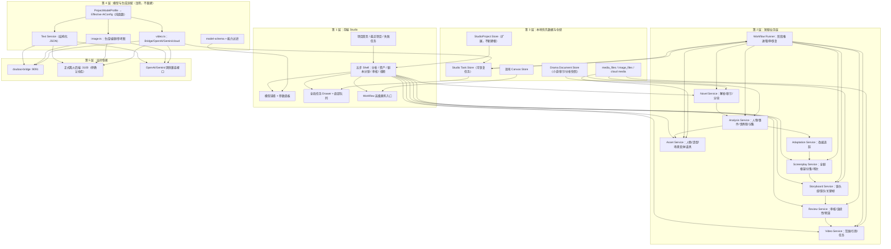
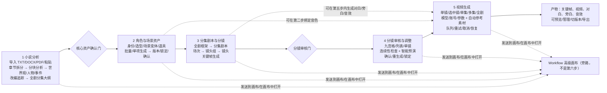
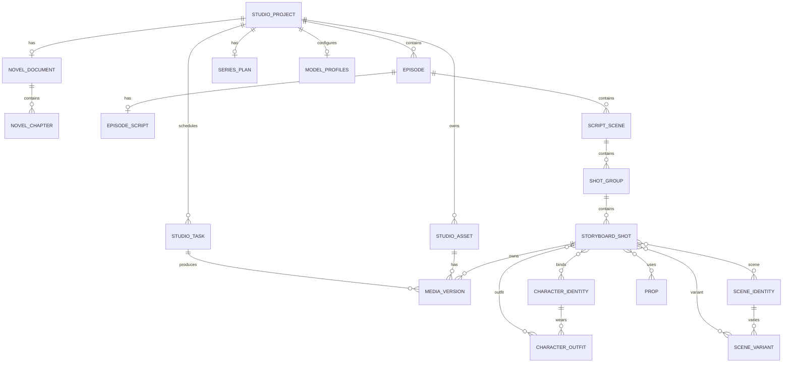
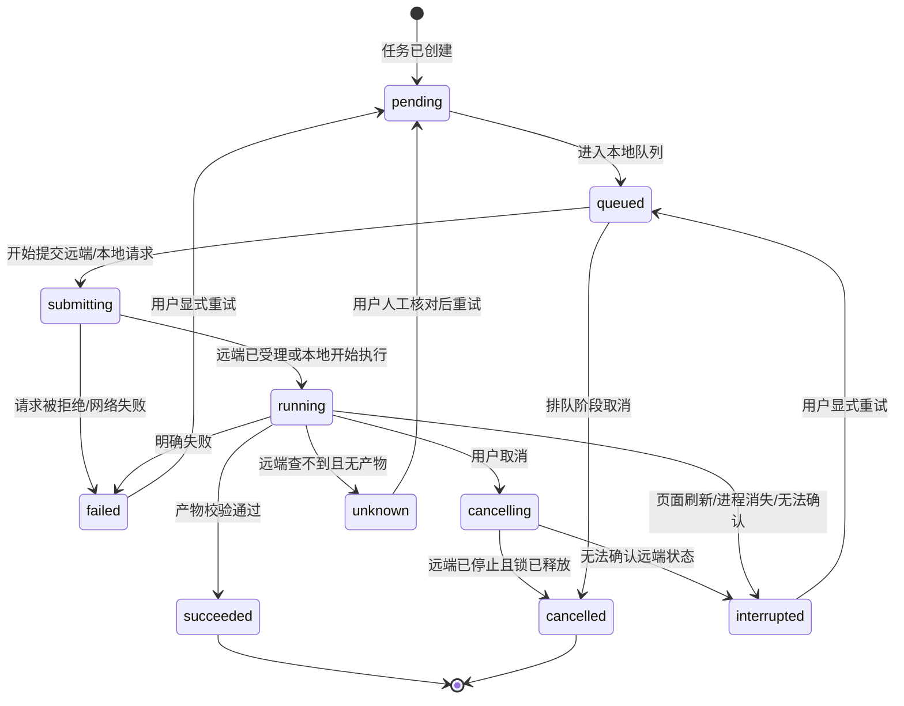
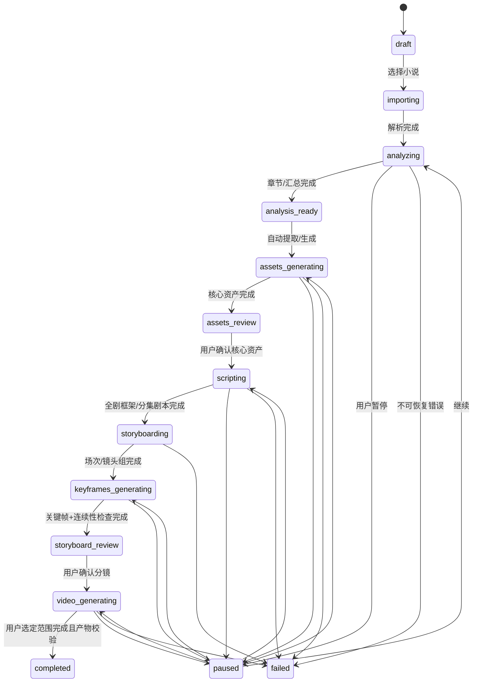

# Lihuo AI 短剧工作室 · 阶段 0 源码审计报告

> 审计日期：2026-11-21  
> 项目根：`C:\Users\qq308\Desktop\lihuo`  
> 当前分支：`main`；最近提交：`27b67bd`  
> 工作区状态：存在大量既有未提交改动（`git status --short` 约 123 项；包含 Dockerfile、登录/积分/云端、设计系统等本轮之前的内容）  
> 本阶段结论：**只审计，未修改任何源码、未新建页面、未新增依赖、未启动真实生成任务。**

---

## 0. 结论摘要（先看这 10 条）

1. **现有 V2 不是目标产品。** 当前 `/drama` 是“项目库 + 剧本/资产/导演/画面/视频/声音六个工作区”，不是“小说分析 → 资产 → 剧本分镜 → 审核 → 视频”的五步流程。页面和数据可以大量复用，但不能把六个工作区当成目标产品交付。
2. **数据根可以复用，不应另起 `DramaProject` 和 `StudioProject` 两套。** 现有 `StudioProject` 已经是项目级根对象，正确做法是扩展它，增加小说、改编、五步状态、镜头组、项目级模型参数等字段；旧 `drama_store` 继续只读迁移。
3. **五步之外不能新增第六步。** 声音应作为第五步内部的“声音”页签（人物音色绑定可在第二步/第三步提前配置），Workflow 画布是高级模式入口，不是第六个工作区。
4. **“云端后端”存在两个版本，文档没有区分。** 仓库 `server/` 只有图片/语音等 4 个同步生成端点，没有 `/api/tasks`、`/api/projects`、`/api/media`、视频任务；桌面外部工程 `C:\Users\qq308\Desktop\lihuo后端` 才是完整 Fastify 后端，包含项目、媒体、视频任务、取消、BYOK。前端默认指向 `127.0.0.1:3100`。**必须先确认哪个是正式后端。**
5. **审计时 3100 与 9091 都没有监听。** 外部后端和豆包 Bridge 的代码存在，但本次没有运行实例，因此“云端视频/云媒体/云项目”的运行时可用性没有被实测确认，只能按源码判断。
6. **云端视频目前不支持首帧/参考图。** `cloud-generation.ts` 在传参考图时直接抛错；`cloudCreateVideoTask()` 只发送 `prompt` 和 `duration`，没有发送比例、分辨率、首帧、尾帧或 `reference_images`。短剧的核心“引用首帧生成视频”在当前云端链路不可用，只有本地 Bridge / OpenAI / Gemini 分支可走。
7. **文本链路不足以支撑几十万字小说。** 当前没有 DOCX/PDF 解析依赖；没有分块、章节级重试、断点恢复；本地 OpenAI 兼容文本走 `/responses`，云端 `cloudAsk()` 把 temperature 固定为 0.7；`AiConfig` 没有 temperature/topP/maxTokens 字段；`text-settings-panel.tsx` 只有 reasoning effort。长文结构化分析必须先补专用文本服务与校验/修复层。
8. **项目级模型参数隔离没有实现。** `AiConfig` 仍是全局唯一参数源，`StudioProjectSettings` 只有模型 ID，没有 `channelId + modelId + capability` 的参数表；`buildGenerationConfig()` 只做画布节点级覆盖。新短剧必须用纯函数从项目 profile 生成“有效配置”，不能写回全局 `AiConfig`。
9. **任务可靠性不达标。** 页面刷新会把 `running/queued/pending/retrying` 全部改成 `failed`；取消只 abort 前端等待，Bridge 没有真正的取消路由；Bridge 恢复时没有持久化“运行中”状态，查不到产物会变成 failed；`costCents` 在短剧任务里从未写入。目标要求的 `submitting/cancelling/cancelled/interrupted/unknown` 都没有完整落地。
10. **可以开始阶段 1，但必须先做 8 个产品/工程决策。** 见文末 J；其中“正式后端是谁”“云端视频是否必须支持参考图”“声音是否只在第五步内”“是否允许新增 DOCX/PDF 依赖”“是否允许修改 Bridge/外部后端”“最终是否需要合成整集”会直接改变实现范围。

---

## A. 现状审计报告

### A.1 当前实际运行架构（以源码为准）

```
┌──────────────────────────────────────────────────────────────┐
│ 浏览器前端 web/                                               │
│  /drama → pages/drama/index.tsx → DramaStudioPage             │
│  六个工作区：script / assets / director / picture / video / sound │
│  项目库：studio/project-manager.tsx                            │
│  任务中心：studio/task-center.tsx（Drawer，非独立页面）         │
└───────────────┬───────────────────────────────┬──────────────┘
                │                               │
     本地优先数据（localforage）          模型/生成服务
                │                               │
  studio_store / studio_tasks            image.ts / video.ts
  drama_store（旧，只读迁移）             cloud-generation.ts
  media_files / image_files               doubao-bridge-adapter.ts
  canvas_store / ai_config_store          lihuo-server.ts
                │                               │
                │                     ┌─────────┴──────────┐
                │                     │                    │
                │              外部完整后端            豆包 Bridge
                │        Desktop\lihuo后端 :3100      :9091（本机）
                │        项目/媒体/视频任务/BYOK       浏览器自动化
                │
         现有无限画布 /canvas/:id
         openStudioWorkflow() 只写入 lihuo:drama / lihuo:drama-shot 节点
```

### A.2 前端真实入口与页面

| 位置 | 事实 |
|---|---|
| `web/src/router.tsx:52` | `/drama` 挂载 `DramaPage`。 |
| `web/src/pages/drama/index.tsx:25-33` | 六个 `StudioWorkspace`：`script/assets/director/picture/video/sound`，另有 `projects` 项目库。 |
| `web/src/pages/drama/index.tsx:54-55` | 有项目时默认进入 `script`；没有项目进入 `projects`。 |
| `web/src/pages/drama/index.tsx:66-72` | `openProject()` / `goWorkspace()` 用 URL 参数 `project/episode/workspace` 维护状态。 |
| `web/src/pages/drama/index.tsx:74-96` | `openStudioWorkflow()` 打开画布项目。 |
| `studio/project-manager.tsx:24-36` | 新建项目要填名称、灵感、单集时长、初始集数；这是一个独立创建弹窗，不是“第一步内的项目创建”。 |
| `studio/script-workspace.tsx:15-20` | 剧本中心有创意/大纲/分集/正文四个页签，但项目设定与小说原文没有独立来源。 |
| `studio/director-workspace.tsx:12-17` | 导演中心负责场次、镜头表、检查器、时长预算、连续性检查。 |
| `studio/picture-workspace.tsx:16-18` | 画面中心逐镜生成首帧，支持版本条与批量/单镜。 |
| `studio/video-workspace.tsx` | 视频中心按镜头/集提交视频任务，但使用全局视频参数与项目模型字段，不是项目级参数方案。 |
| `studio/sound-workspace.tsx` | 声音中心已存在（对白/旁白/音效/BGM），目标五步下不能作为第六个导航步骤。 |
| `studio/task-center.tsx:11-12` | 任务中心明确写着“取消只停止前端等待；视频远端任务可能仍在运行”。 |

### A.3 当前数据模型与持久化

| 文件/键 | 事实 |
|---|---|
| `web/src/types/studio.ts:268-288` | `StudioProject` 是项目根：`settings/bible/visualStyle/assets/episodes/legacySequenceId`。 |
| `web/src/types/studio.ts:247-266` | `StudioEpisode` 有 `script/scenes/shots/continuityReport`，没有小说章节、场次脚本对象、镜头组。 |
| `web/src/types/studio.ts:129-206` | `StudioShot` 有景别、机位/角度（字段 `camera`）、运镜、构图、人物位置/朝向、台词、首帧/尾帧、版本、远端凭据；没有 `shotGroupId`、视线、轴线、道具状态、结构化绑定、多关键帧角色。 |
| `web/src/types/studio.ts:208-235` | `StudioAsset` 用 `kind` 区分人物/场景/服装/道具，但服装没有 `characterId` 归属，场景没有变体结构，资产没有锁定/确认/来源引用字段。 |
| `web/src/types/studio.ts:292-332` | `StudioTaskStatus` 只有 `pending/queued/running/succeeded/failed/canceled/retrying`；`StudioTask` 没有 `idempotencyKey`、`providerTaskId`、`errorCode`、`resultAssetIds`、`modelSnapshot`、`promptSnapshot`、`referenceAssetIds`。 |
| `web/src/stores/use-studio-store.ts:638-644` | 项目保存在 `storageKey("studio_store")`，localforage JSON；hydration 只设 `hydrated` 并按 `migrationDone` 触发旧库迁移。 |
| `web/src/stores/use-studio-store.ts:655-672` | 旧 `drama_store` 只读；解析失败不覆盖、不把 `migrationDone` 置 true；旧 store 始终保留。**这部分是正确且要保留的。** |
| `web/src/stores/use-studio-tasks.ts:46` | 任务最多保留 300 条。 |
| `web/src/stores/use-studio-tasks.ts:121` | 前端并发默认 3，可设 1–6。 |
| `web/src/stores/use-studio-tasks.ts:172-177` | **刷新后 `running/queued/pending/retrying` 一律改成 `failed`**，只留一句“可续查/重新执行”。这不符合目标状态机。 |
| `web/src/stores/use-studio-tasks.ts:142-153` | `cancel()` 只移除本地队列、abort `AbortController`、立即写 `canceled`；不调用远端取消。 |
| `web/src/services/file-storage.ts:13-26` | 本地素材进 `media_files`，云端模式下走 `cloud-media` 上传。 |
| `web/src/services/file-storage.ts:72-86` | `cleanupUnusedMedia()` 会删除未被项目 JSON 引用的素材；新小说原文若放入项目 JSON 会被误卷入清理，所以必须独立文档库。 |
| `web/src/services/image-storage.ts` | 旧图片、预览、生成日志分别在 `image_files/image_previews/image_generation_logs`。 |
| `web/src/services/cloud-media.ts:36-52` | 云端媒体签直传 + commit；只在 `channelMode=cloud` 且已登录时启用。 |

### A.4 模型与生成链路

| 层 | 真实实现 | 关键缺口 |
|---|---|---|
| 配置 | `web/src/stores/use-config-store.ts`：`AiConfig` 含 `model/textModel/imageModel/videoModel/audioModel`、`size/quality/count/background`、`videoSeconds/vquality/videoMode/videoGenerateAudio/videoWatermark`、`reasoningEffort`、`doubaoAccountId`。 | 没有 temperature/topP/maxTokens；没有项目级参数表；没有按 `channelId+modelId+capability` 的参数。 |
| 模型选择 | `selectableModelsByCapability(config, capability)` 从当前 channels 筛；云模型通过 `use-auth-store.ts:28-56` 拉到 channels。 | 模型列表来源正确，但项目设置只是字符串，没有带参数 profile。 |
| 参数 Schema | `web/src/stores/model-schema.ts:143-263` 硬编码：豆包/Dola 视频、Seedream 5.0、gpt-image-1；其他返回 null。 | 图片面板并未按 Schema 渲染；文本没有 Schema；通用视频没有 Schema；`resolveVideoParamSchema()` 对不认识的模型退旧面板。 |
| 图片生成 | `services/api/image.ts:698-773`：`requestGeneration()` 直接读 `config.size/quality/count/background`；豆包走 Bridge；云端走 `cloudGenerateImages`。 | **`requestGeneration` 不接受参考图**；资产正式图不能从用户上传参考图生成。参考图只能走 `requestEdit()` 或画布编辑；`runAssetImage()` 只调用 `requestGeneration`。 |
| 图片编辑 | `image.ts:775-856`：`requestEdit()` 支持 references；豆包上传参考图；OpenAI 走 `/images/edits`；Gemini 走多模态。 | 短剧资产、镜头绑定没有统一调用它；镜头的 `referenceKeysForShot()` 只取已确认资产的 `officialRef`，且最多 6 张。 |
| 文本 | `image.ts:867-914`：`requestImageQuestion()`；豆包网页对话、Gemini、OpenAI `/responses`。云端 `cloud-generation.ts:216-...` 走 `/api/chat/stream`。 | 无 temperature/topP/maxTokens；云端把 temperature 写死 0.7；本地 OpenAI 兼容不是 chat/completions；无 JSON Schema/repair。 |
| 视频 | `services/api/video.ts:78-142`：豆包 Bridge 分支上传 references、发送 `ratio/duration`；OpenAI/Gemini/plugin 分支各自组装；`cloud-generation.ts:164-210` 云端只建任务并轮询。 | **云端没有 references，且只发 duration**；Bridge 只消费 `ratio/duration`；视频任务的参数快照、费用、错误码没有回写短剧任务。 |
| 生成代理客户端 | `web/src/services/api/lihuo-server.ts`：有 `generate/generateForm/createVideoTask/getTask/cancelTask/projects/media/points` 等客户端方法。 | 客户端方法不等于后端已部署；当前仓库 `server/` 与外部 `lihuo后端` 不一致。 |
| 工程覆盖 | `buildGenerationConfig()` 在 `lib/canvas/canvas-generation-helpers.ts` 中提供节点级覆盖。 | 这是画布节点语义，不是短剧项目语义；不能直接把节点对象塞给短剧。 |

### A.5 后端真实情况（两套，必须区分）

**A.5.1 仓库内 `server/`**

- `server/src/http/server.ts` 注册的是登录、用户、模型、聊天、生成代理、管理端等路由。
- 没有 `/api/projects`、`/api/tasks`、`/api/media`、BYOK 渠道、积分页面接口。
- `server/src/modules/generate.ts` 的端点白名单只有：`image-generations`、`image-edits`、`audio-speech`、`embeddings`；**没有 video-generations**。
- `server/README.md:132-148` 也明确写“4 个端点”。
- 因此：**如果用仓库内 `server/`，前端 `lihuo-server.ts` 的大量云端方法会 404，云端视频完全不可用。**

**A.5.2 桌面外部工程 `C:\Users\qq308\Desktop\lihuo后端`**

- 独立 Git 仓库，分支 `feature/p1-unified-channels`，最近提交 `6514e1b`，74 项未提交改动。
- Fastify 工程，`src/app.ts` 注册了项目、资产、媒体、生成、任务、BYOK 等路由。
- 视频是异步任务：`POST /api/generate/video-generations`、`GET /api/tasks/:id`、`POST /api/tasks/:id/cancel`；有租约恢复、超时退款、产物落媒体库。
- 这是目前前端云端客户端更匹配的后端，**但它不在当前项目目录内，也没有在本机 3100 运行**。
- `docs/ai-handover/BACKEND_PLAN.md:426` 说“后端已落地为独立工程 lihuo-backend（工作区外，桌面 lihuo后端/）”，但 `server/README` 和仓库 `server/` 没有同步。文档混用 `server/` 与 `lihuo-backend` 两个名字，是当前最大的文档/源码差异之一。

### A.6 豆包/Dola Bridge 的真实能力与问题

| 项 | 源码事实 | 对短剧的影响 |
|---|---|---|
| 地址 | `doubao-bridge/server.mjs`，默认 `127.0.0.1:9091`。 | 本地视频主链路依赖本机 Bridge；Bridge 未启动时用户必须看到中性提示，不能报“模型错误”。 |
| 账号隔离 | 每个账号 `DBB_STATE_DIR = .doubao-accounts/<id>/state`。 | 豆包/Dola 不能混用；短剧项目要按 provider 过滤账号。 |
| 并发 | `MAX_JOBS_PER_ACCOUNT = DOUBAO_MAX_PARALLEL || 3`（`server.mjs:482-483`）。 | 文档写“同一账号并发 1”已过时；全剧批量必须自己排队，不能无限并发。 |
| 账号选择 | `server.mjs:548-...` 的 `pickAccountByMode()`：manual 在配额不通过时会顺延下一个可用账号；auto 按顺序挑。 | **与用户“短剧工作流不得自动换号”冲突**。新短剧必须用固定账号策略，或要求用户显式确认换号；不能沿用画布全局行为。 |
| 任务持久化 | 内存 `jobs` Map + 账号目录下的 job spec 文件 + 产物文件索引；`recoverJob()` 在查任务时按文件恢复。 | 已完成且有产物的任务可恢复；运行中状态没有持久化，`listJobs` 仍只在内存，重启后列表为空。 |
| 取消 | **没有 `POST /api/jobs/:id/cancel` 路由**；前端 `cancel` 只停止等待。Runner 由 `spawn()` 启动，仅超时/异常时 kill。 | 目标要求的“真正取消、释放账号锁、不关共享浏览器”当前做不到。必须先改 Bridge，不能只在 UI 上写“已取消”。 |
| 参数 | `run-doubao.mjs` 会选模型、比例、时长；Bridge 把 `requestedParams.ratio/duration` 传给 Runner。 | 文档 `DEVELOPMENT.md:113` 说“不传比例/时长”已过时。Bridge 只支持它实际点选的参数，不支持音频/水印等未实现参数。 |
| 产物 | 视频结果文件按 job id/index 提供；`pollVideoGenerationTask()` 查不到 job 直接返回 failed。 | 恢复时必须区分 `interrupted/unknown`，不能把“查不到”直接当失败后重复提交。 |

### A.7 现有短剧动作与业务能力

- `lib/studio/actions.ts` 已有：资产生图、镜头生图、镜头视频、配音/旁白/音效、剧本/大纲/分集/拆镜/补镜/连续性检查。
- `lib/studio/prompt.ts` 已具备项目视觉规范 + 人物/场景/服装/道具资产 + 镜头参数的提示词自动组装，`buildShotImagePrompt()` / `buildShotVideoPrompt()` 可复用。
- `lib/studio/deps.ts` 已具备“资产正式版变化 → 找出已生成图片/视频的受影响镜头”，但：
  - 只识别已生成媒体，不标记尚未生成的下游任务；
  - 只按资产名/ID粗匹配，没有人物造型、场景变体、道具结构绑定；
  - 不覆盖音频/旁白/音效；
  - 不会自动重生成，这符合“不要删除用户成果”的原则，可以保留。
- `lib/studio/lint.ts` 已有基础镜头 lint（时长、同景别、光位、位置/朝向），但缺少：
  - 摄影机轴线、视线方向、人物左右关系；
  - 道具状态、事件顺序、情绪过渡；
  - 镜头组共享空间规则。
- `lib/studio/workflow.ts` 只把项目和镜头写成 `lihuo:drama` / `lihuo:drama-shot` 节点；资产、剧本、关键帧、视频结果没有通用“发送到画布”入口。

### A.8 现有 V2 的真实可用边界

**已经可复用：**
- 项目/集/镜头/资产/媒体版本/任务的基本 CRUD；
- 资产正式版 + 候选版本 + 版本条；
- 单镜/批量生成、失败重试；
- 项目 JSON 导出、单素材下载；
- 旧 `drama_store` 只读迁移；
- 无限画布项目/镜头节点互通；
- 六个工作区里已有的表格、卡片、检查器、任务抽屉、媒体预览。

**不能直接当作目标交付：**
- 没有小说导入、章节、原文位置、改编追踪；
- 没有人物身份与造型的正式关系，没有场景变体、道具独立实体；
- 没有全剧框架、场次脚本对象、镜头组；
- 没有五步状态机、核心资产确认门、分镜审核门；
- 没有全局任务恢复与真正取消；
- 没有项目级模型参数隔离；
- 没有云端首帧视频；
- 没有长文分析的分块/断点/局部重试；
- 没有 DOCX/PDF 解析依赖。

---

## B. 文档与真实源码差异表

| # | 文档说法 | 真实源码/状态 | 判定 | 处理建议 |
|---|---|---|---|---|
| 1 | `PROJECT_OVERVIEW.md:52`：分支 `chore/integrate-cleanup`；回滚用 `git checkout -- .` / `git reset --hard baseline-20261110` | 实际分支 `main`，最近 `27b67bd`，工作区约 123 项未提交改动 | **高危过期指令** | 阶段 1 立即改写；禁止任何 `reset --hard` / `checkout -- .`；旧提交不能覆盖当前工作区 |
| 2 | `KNOWN_ISSUES.md:94-96`：目录不含 `.git`，无法提交/打 tag | 实际 `.git` 存在，`main` 有提交 | 过期 | 改为“Git 可用但有大量未提交改动，提交前必须确认范围” |
| 3 | `server/README.md:132-148`：生成代理 4 个端点，没有视频 | 仓库 `server/` 确实如此；外部 `lihuo后端` 有视频任务 | 两个事实都成立但未标明对象 | 文档必须区分 `server/` 与 `Desktop\lihuo后端`，并指定正式后端 |
| 4 | `BACKEND_PLAN.md:426-433`：后端 P0 已完成，视频异步任务、媒体直传已落地 | 外部工程有；仓库 `server/` 没有；本机 3100 未运行 | 文档把“外部工程完成”当成“当前仓库/运行实例完成” | 以外部工程为候选正式后端；补一条“当前未启动、未联调”说明 |
| 5 | `ARCHITECTURE.md:125`：`MAX_JOBS_PER_ACCOUNT = 1` | `doubao-bridge/server.mjs:482-483` 默认 3 | 过期 | 按源码更新；短剧排队按账号真实并发做 |
| 6 | `DEVELOPMENT.md:113`：dbb 不提供比例/时长参数，前端不传 | `run-doubao.mjs:1014-1060` 实际选模型/比例/时长；`server.mjs` 接收 `requestedParams` | 过期 | 改为“Bridge 支持模型/比例/时长；不支持的参数不显示、不提交” |
| 7 | `DEVELOPMENT.md:114`：同一账号并发 1，前端不自动换号 | 源码并发默认 3；`pickAccountByMode` manual 有配额顺延 | 过期且与用户策略冲突 | 画布行为可保留，但短剧必须单独固定账号策略 |
| 8 | `KNOWN_ISSUES.md:21`：自动选号不可用 | `pickAccountByMode` 有 auto 分支，能按顺序选；额度只有能力级 block，不是数值额度 | 过期/表述过窄 | 改为“自动选号可运行，但额度不可确认、manual 可能顺延，短剧禁止自动换号” |
| 9 | `ARCHITECTURE.md:167`：豆包任务只存在内存 Map，重启丢失 | 有 job spec + 产物文件恢复，但状态不持久、列表不恢复 | 部分过期 | 改为“产物可恢复，运行态/列表不可靠；取消缺失” |
| 10 | `HANDOFF.md:60`：密钥只存在浏览器 localforage，不会上传 | `use-config-store.ts:519-531` 持久化 `withoutCredentials()`，channels apiKey 置空；启动清历史 Key | **错误** | 改为“Key 只在当前会话内存；云端 Key 在后端加密存储；浏览器不落盘” |
| 11 | `design-system/components/task-center.md`：状态只有 queued/running/succeeded/failed/cancelled；`task-center` 页面未实现 | 短剧已有 Drawer；状态多 `pending/retrying`，少 `submitting/cancelling/interrupted/unknown` | 契约落后于目标 | 文档升级为完整 10 状态；Drawer 可保留但必须补分类/详情/恢复 |
| 12 | `BACKEND_PLAN.md`：视频生成后端已完成 | 前端 `cloudCreateVideoTask` 遇到 references 直接抛错；只传 duration | **端到端未完成** | 不能把云端视频作为首帧主链路；先本地，或补后端+前端参考图协议 |
| 13 | `STUDIO_V2.md` 描述 V2 为六工作区 | 当前源码确实六工作区 | 与目标五步冲突，不是文档错误 | 保留为“现状文档”，新增五步目标文档，不要改写成已完成五步 |
| 14 | `PROJECT_OVERVIEW.md:52` 说 Git 基线是 `baseline-20261110` | 当前 `main` 有后续提交 | 信息过期 | 版本基线改为当前提交并在发版时更新 |
| 15 | `docs/ai-handover/STUDIO_V2.md` 说 V2 的 35 文件/562KB diff 是短剧改动 | 当前工作区约 123 项，混有大量非短剧改动 | 历史快照失效 | 新阶段每个阶段输出自己的文件清单与 diff，不沿用旧 diff 口径 |

---

## C. 新短剧模块架构图

### C.1 分层架构



### C.2 关键架构决策

1. **单一项目根**：`StudioProject` 扩展为 `DramaProject` 的正式形态；不新增第二个 `DramaProject` 类型和第二个 store。文中“DramaProject”只作为产品概念的别名。
2. **小说与大文本单独存**：新增 `drama_documents` localforage 实例，键为 `novel:<id>:raw` / `novel:<id>:chapter:<id>` / `novel:<id>:analysis:<stage>`；`StudioProject` 只存 `novelId` 与元数据，避免项目 JSON 膨胀。
3. **五步只做壳，业务复用现有动作**：`StudioAssetsWorkspace/Director/Picture/Video/Sound` 不删除，重新编排到五个步骤的内部页签；旧组件可以保留为 legacy。
4. **项目级模型 profile 是纯数据**：`channelId + modelId + capability` 为键，纯函数产出有效 `AiConfig`；绝不写全局配置、不持久化 API Key。
5. **任务记录是唯一事实源**：页面只读任务状态，不根据按钮点击推断成功；项目状态只能由任务终态/审核动作推进。
6. **不复制画布、不复制模型中心**：Workflow 调用现有 `/canvas/:id`，模型选择器复用 `selectableModelsByCapability` 与现有 settings panel。

### C.3 当前 V2 → 目标架构的映射

| 目标概念 | 当前可复用对象 | 处理方式 |
|---|---|---|
| DramaProject | `StudioProject` | 扩展字段；不新建第二套根对象 |
| NovelDocument/Chapter | 无 | 新增 types + 独立 document store |
| Episode | `StudioEpisode` | 扩展 `plan/scriptScenes/status/adaptationRecords` |
| Character/Outfit/Scene/Prop | `StudioAsset(kind)` | 增加 `characterId/sceneId/variants/locked/confirmed/sourceRefs`；保留旧 kind |
| EpisodeScript | `StudioScript` | 扩展全剧/分集版本与来源 |
| ScriptScene | `StudioScene` | 扩展 `action/dialogue/status/shotGroups` |
| ShotGroup | 无 | 新增类型；旧镜头按场景自动生成默认组 |
| StoryboardShot | `StudioShot` | 扩展 `shotGroupId/eyeline/blocking/cameraPosition/soundDesign/continuityRules/bindings/keyframeRole` |
| GenerationTask | `StudioTask` | 扩展目标状态、快照、错误码、结果资产、费用 |
| Asset / Keyframe | `StudioAsset` + `StudioMediaVersion` | Keyframe 作为带 role 的 media version；不内联 base64 |
| ModelProfile | `StudioProjectSettings` 的模型字符串 | 扩展 `modelProfiles` + `paramsByModel` |

---

## D. 五步工作流图



### D.1 项目创建的位置

- 项目首页只负责“新建短剧 / 最近项目 / 失败任务”。
- 点击“新建短剧”后直接创建 `draft` 项目并进入**第一步**的分析工作台；项目名称、小说文件、文本粘贴都在第一步完成。
- 不新增“项目立项”步骤；原 `project-manager.tsx` 的名称/集数弹窗改成“新建并进入第一步”，不再让用户预先猜集数（集数由 `all` 分析结果决定）。

### D.2 固定配置

- `workflowMode = "all"`：全文分析、全剧资产、全剧分集、全剧分镜；批量操作可单集/选中集/全剧；绝不一次性无限并发。
- `automationMode = "auto"`：自动推进，但只有两个人工审核门：
  - A. 核心人物主形象 + 核心场景确认；
  - B. 分镜审核确认。
- 支持暂停、继续、停止、局部重跑。
- `auto` 只表示工作流自动，不表示豆包账号自动切换；短剧固定账号/显式换号。
- `adaptationMode = "adapt"`：保留核心身份/关系/世界观/主线/关键事件/成长/因果/伏笔；允许压缩、合并、调序、提前冲突、优化对白；每条改编记录 `sourceRefs/changeType/originalContent/adaptedContent/reason/affectedEpisodes`。

### D.3 自动推进规则（由任务结果驱动）

1. 小说解析 + 章节分析 + 全局汇总完成 → `analysis_ready` → 自动触发资产提取/生成。
2. 核心资产生成完成 → `assets_review`，等待用户确认；未确认核心资产不得成为正式分镜参考。
3. 核心资产确认 → 自动生成全剧框架、分集剧本、场次与镜头组、关键帧。
4. 关键帧完成 → 自动连续性检查 → `storyboard_review`。
5. 分镜确认 → `video_generating` 准备；**不自动提交真实视频任务**，由用户选范围后提交。
6. 任一步骤的部分失败只标记该步骤 `partial`，不阻塞其他集/镜头；核心资产失败则卡住对应下游并在 UI 显示原因。

### D.4 声音与最终合成

固定五步不允许新增“声音中心”导航。建议：
- 第二步资产详情里绑定人物音色（属于人物资产）；
- 第三步剧本里填写对白/旁白/音效文本；
- 第五步内部提供“视频生成 / 声音”两个页签，声音页签复用现有 `StudioSoundWorkspace`，只生成对白/旁白/音效资源并进任务中心；
- **不做时间轴剪辑/视频合成**。最终交付是分镜视频、关键帧、对白/旁白/音效等独立资产；如果用户要求“一集可直接播放的合成片”，那是另一个产品能力，需要单独确认（见 J）。

---

## E. 页面布局图

### E.1 项目首页（不是五步中的一步）

```
┌ 顶部：Lihuo 短剧工作室 · 新建短剧 · 全局任务中心 ────────────────┐
│ 最近项目（封面/名称/集数/当前步骤/进度）                          │
│ ┌──────────────┐ ┌──────────────┐ ┌──────────────┐              │
│ │ 项目卡        │ │ 项目卡        │ │ 新建项目卡    │              │
│ │ 进度 3/5      │ │ 进度 1/5      │ │ + 新建        │              │
│ └──────────────┘ └──────────────┘ └──────────────┘              │
│ 失败/中断任务（项目/集/镜头/原因/继续）                            │
└──────────────────────────────────────────────────────────────────┘
```

- 项目卡显示：项目名、封面（首个已确认场景/关键帧）、集数、当前步骤、进度、最近任务、失败数。
- “新建短剧”直接进入第一步，不先填集数。

### E.2 第一步：文档分析工作台

```
┌ 顶部：项目名 / 小说名 / 五步进度 1 ───────────────────────────────┐
│ 左 260              │ 中：分析结果（可切换页签） │ 右 340        │
│ 章节导航            │ 小说信息 / 世界观          │ AI 助手        │
│ 全文搜索            │ 人物体系 / 剧情             │ 文本模型        │
│ 章节状态（成功/失败）│ 分集规划 / 资产提取         │ 文本参数        │
│ 断点续跑            │ 改编追踪（原文 vs 改编）     │ 分析任务/进度    │
└──────────────────────────────────────────────────────────────────┘
底部：解析任务条（按章节重试，不重跑全部）
```

- 空态：拖入 TXT/DOCX/PDF 或粘贴文本；明确提示“扫描版 PDF 无法提取文字”，不假装读完。
- 原文、章节偏移、AI 结果三栏可追溯；改编项用来源标签（原著 / 改编 / AI 补充）区分。

### E.3 第二步：视觉资产管理工作台

```
┌ 顶部：项目名 / 五步进度 2 / 核心资产确认 ─────────────────────────┐
│ 左 240              │ 中：资产卡片网格              │ 右 360       │
│ 全部/人物/造型      │ 人物/造型/场景/场景变体/道具   │ 当前资产详情   │
│ 场景/道具           │ 批量选择 / 生成 / 确认         │ 原文依据       │
│ 待生成/待确认/已确认│ 版本缩略图 / 锁定状态          │ 提示词/参考图  │
│ 搜索/筛选           │ 单项重生成                    │ 图片模型/参数  │
│                     │                               │ 生成历史/画布  │
└──────────────────────────────────────────────────────────────────┘
```

- 核心人物主形象、核心场景必须显式确认；未确认不能成为正式分镜参考。
- 人物身份和造型分开：造型卡片归到 `characterId`，换装不新建人物。
- 场景变体共享 `sceneId`，只变时间/天气/破坏/光照。
- 批量失败只重试失败项，成功资产不重新生成；锁定资产阻止自动替换。

### E.4 第三步：分集故事板工作台

```
┌ 顶部：项目名 / 五步进度 3 / 剧本-分镜切换 ────────────────────────┐
│ 左 280              │ 中：剧本 + 镜头组 + 镜头卡片 │ 右 360        │
│ 全剧分集            │ 全剧框架 / 本集剧本           │ 镜头参数       │
│ 场次树              │ 场次顺序 / 镜头组             │ 人物/造型/场景/道具绑定 │
│ 镜头组              │ 镜头卡片 / 关键帧             │ 提示词         │
│                     │ 九宫格预览（辅助，不是唯一）   │ 图片模型/参数   │
└──────────────────────────────────────────────────────────────────┘
底部 96：当前场次镜头顺序 / 镜头组连续性 / 批量关键帧状态
```

- 第三级结构固定：`Episode → ScriptScene → ShotGroup → StoryboardShot`。
- 一个镜头组共享场景、时间、天气、站位、轴线、运动方向、道具状态；不能把所有镜头当独立图片。
- 关键帧支持单张/多张/首尾帧/单格重生成；正式版与候选版分离。

### E.5 第四步：全屏视觉审核工作台

```
┌ 顶部 56：集数 / 场次 / 镜头组 / 审核状态 / 视图切换 ──────────────┐
│ 中央：九宫格 / 镜头墙 / 单镜大图（保留大图空间）                    │
│                                               │ 右 300            │
│                                               │ 镜头详情          │
│                                               │ 连续性报告        │
│                                               │ 修改建议/接受/忽略 │
└──────────────────────────────────────────────────────────────────┘
底部 80：镜头顺序条 / 批量确认 / 批量重生成 / 锁定 / 版本
主按钮：确认分镜，进入视频生成
```

- 右侧面板不得超过 300–320px，避免压缩画面；单镜大图必须能全屏。
- AI 连续性问题必须关联 shotId/shotNo；锁定的镜头不能自动改，只提示。

### E.6 第五步：视频生产工作台

```
┌ 顶部：项目名 / 五步进度 5 / Studio | Workflow ─────────────────────┐
│ 左 240              │ 中：视频结果卡片                │ 右 360        │
│ 全剧集数            │ 当前集/全部结果                 │ 视频模型        │
│ 生成状态            │ 预览/失败原因/生成记录          │ 渠道/账号       │
│ 单集/多集/全剧筛选   │ 关键帧引用缩略图                │ 参数（按真实 Schema）│
│ 声音页签            │ 版本切换/导出                   │ 参考素材自动组装  │
└──────────────────────────────────────────────────────────────────┘
底部 180（可折叠）：持续任务队列 / 失败隔离 / 重试 / 取消 / 恢复
```

- 第五步内部“视频 / 声音”两个页签；不新增第六步。
- 参数只显示当前模型真实支持的字段；不支持的字段隐藏，不显示假开关。
- 云端模型若没有首帧/参考图能力，必须禁用并说明原因，不能静默丢掉参考图。

### E.7 视觉规范（沿用现有设计系统）

- 颜色只从 `canvasThemes` / `app-theme.ts` / CSS 变量取；业务组件不硬编码品牌色。
- 画布按钮低视觉重量：透明底、仅 hover 反馈；不为面板加多余卡片阴影。
- 设计系统 `DESIGN.md` 明确禁止玻璃拟态/霓虹/装饰渐变；新页面遵循“雾、火、纸”和低视觉重量。
- 五个步骤使用各自的工作台布局，不强迫同一套三栏模板。

---

## F. 数据实体关系图



### F.1 关键实体字段（目标）

**StudioProject（产品名 DramaProject）扩展**
```
id, name/title, novelId?, workflowMode:"all", automationMode:"auto",
adaptationMode:"adapt", projectStatus, currentStep, stepStates,
seriesPlan?, modelProfiles?, workflowRun?, sourceRefs?, legacySequenceId?
```

**NovelDocument（独立文档库）**
```
id, projectId, sourceFileName, sourceMimeType, sourceAssetId/rawTextRef,
chapterIds[], parseStatus, parseError, version, createdAt, updatedAt
```

**NovelChapter**
```
id, novelId, chapterIndex, title, contentRef, startOffset, endOffset
```

**AdaptationRecord**
```
id, projectId, episodeId?, sourceRefs[], changeType:
"keep|compress|merge|reorder|add|delete",
originalContent?, adaptedContent, adaptationReason, affectedEpisodes[],
origin:"source|adapted|ai_added"
```

**StudioEpisode 扩展**
```
plan: {synopsis, dramaticGoal, mainConflict, climax, endingHook,
       characterIds[], sceneIds[], sourceRefs[], adaptationRecords[], status}
scriptScenes: ScriptScene[]   // 或保留 scenes 兼容 + 新字段
status
```

**Character / Outfit / Scene / Variant / Prop（用 StudioAsset 承载）**
- 人物：`kind="character"`，`identityDescription/ageSetting/personality/motivation/appearance/relationshipIds/sourceRefs/firstAppearance/primaryAssetId/status/core/confirmed/locked`
- 造型：`kind="costume"` + `characterId` + `usageScene/period/referenceAssetIds`；不新建人物 ID。
- 场景：`kind="scene"` + `spatialLayout/environment/lighting/firstAppearance/sourceRefs`；`variants[]` 共享 scene id。
- 变体：`variantName/weather/timeOfDay/lighting/damageState/referenceAssetIds`
- 道具：`kind="prop"` + `material/appearance/ownerCharacterId/sourceRefs/出场集数`

**ScriptScene / ShotGroup / StoryboardShot 扩展**
```
ScriptScene: id, episodeId, sceneId, order, timeOfDay, location,
             characterIds[], action, dialogue, status, shotGroups[]
ShotGroup:   id, scriptSceneId, order, spatialContext, axisRules,
             characterBlocking, sharedContinuityRules
StoryboardShot: id, shotGroupId, episodeId, order, duration,
  shotSize, cameraPosition, cameraAngle, cameraMovement, focalLength,
  composition, actorBlocking, eyeline, action, expression, emotion,
  environment, lighting, dialogue, soundDesign, continuityRules,
  characterBindings[], outfitBindings[], sceneBindings[], propBindings[],
  imagePrompt, videoPrompt, keyframeAssetIds[], keyframeRoleMap,
  status, version
```

**StudioTask 扩展**
```
id, projectId, episodeId, resourceId, resourceType, taskType,
status: pending|queued|submitting|running|succeeded|failed|
        cancelling|cancelled|interrupted|unknown,
modelSnapshot, promptSnapshot, referenceAssetIds[], paramsSnapshot,
provider, channelId, accountId, providerTaskId, idempotencyKey,
progress?, errorCode?, errorMessage?, resultAssetIds[], costCents?,
retryCount, createdAt, startedAt, finishedAt, updatedAt, logs[]
```

### F.2 关系约束

- 全剧人物/场景/道具属于 `StudioProject`，跨集共享，不因多集出现复制多份身份。
- `CharacterOutfit` 属于 `CharacterIdentity`；`SceneVariant` 属于 `SceneIdentity`。
- `ScriptScene` 属于 `Episode`；`ShotGroup` 属于 `ScriptScene`；`Shot` 属于 `ShotGroup`。
- 媒体文件只存 `storageKey` / `mediaKey`，业务 JSON 不内联 Base64。
- `NovelDocument/Chapter` 独立存储，避免 `cleanupUnusedMedia()` 与项目 JSON 体积问题。

---

## G. 任务状态机

### G.1 统一任务状态机



### G.2 状态规则

| 规则 | 要求 |
|---|---|
| 状态只由任务结果驱动 | 点击按钮只产生 `pending/queued`；不能点一下直接写 `succeeded`。 |
| 无产物不得成功 | `succeeded` 必须有通过校验的 `resultAssetIds` 或文本结果；视频必须有可读文件。 |
| 刷新不得伪造失败 | `running` 刷新 → `interrupted`；`queued` 可恢复排队；`pending` 可重新开始。 |
| 未知不得自动重提 | `unknown/interrupted` 必须先查远端或用户确认，不能自动重复提交。 |
| 取消必须真停止 | `cancelling` 只在远端确认停止/账号锁释放后 → `cancelled`；否则 → `interrupted`。 |
| 失败隔离 | 单个镜头失败只影响该任务和该镜头；同集其他镜头继续。 |
| 费用只认真实 | `costCents` 来自 `X-Lihuo-Cost-Cents` / 云端响应；本地 Bridge 未计费写 0 并标注“未计费”。 |
| 状态映射 | 后端 `cancel_requested → cancelling`；`canceled → cancelled`；查不到 → `unknown`；Bridge 重启中运行态 → `interrupted`。 |

### G.3 项目/步骤状态机



步骤状态独立：
```
idle | pending | running | waiting_review | completed | partial | failed | paused
```
- 全剧 30 集中 1–28 成功、29 失败、30 成功：项目仍是 `video_generating` 或最终 `completed`，但 `stepStates.video = partial`，失败镜头单列，不能把全剧标成 failed。
- 只有 `completion` 通过所有必需产物校验，或用户显式接受“部分完成”时才允许 `completed`；报告 UI 必须显示“部分完成”标记。

---

## H. 文件新增/修改清单（阶段 0 建议，不含已执行改动）

> 本阶段没有新增或修改任何源码。以下是阶段 1–6 的候选清单；实际落地时按阶段拆分，禁止一次性全改。
> 路径相对于 `C:\Users\qq308\Desktop\lihuo`。

### H.1 新增（建议）

| 文件 | 责任 | 阶段 |
|---|---|---|
| `web/src/types/drama-document.ts` | NovelDocument/NovelChapter/NovelAnalysis/AdaptationRecord 类型 | 2 |
| `web/src/lib/drama/document-store.ts` | `drama_documents` localforage：原文/章节/分析快照；不写入项目 JSON | 2 |
| `web/src/lib/drama/parser.ts` | TXT 直读；DOCX/PDF 懒加载解析；章节拆分、偏移、空文本检测 | 2 |
| `web/src/lib/drama/novel-analysis.ts` | 分块、章节级事实提取、全局汇总、断点/局部重试 | 2 |
| `web/src/lib/drama/adaptation.ts` | 改编追踪、原著/改编/AI 补充标记 | 2 |
| `web/src/lib/drama/episode-plan.ts` | 全剧分集规划、批量生成与合并 | 2 |
| `web/src/lib/drama/asset-extract.ts` | 人物/造型/场景/变体/道具提取与身份归一 | 3 |
| `web/src/lib/drama/model-profile.ts` | `channelId+modelId+capability` 参数键、有效配置纯函数、切换过滤 | 1/3 |
| `web/src/lib/drama/workflow-runner.ts` | 阶段游标、暂停/继续/停止、局部重跑、步骤状态汇总 | 1/2 |
| `web/src/lib/drama/task-reconcile.ts` | 刷新后恢复、远端核对、unknown/interrupted、幂等重试 | 6 |
| `web/src/services/api/text.ts` | 结构化文本请求：JSON 模式/校验/修复；云端与本地统一入口 | 2 |
| `web/src/pages/drama/studio/analysis-workspace.tsx` | 第一步文档分析工作台 | 2 |
| `web/src/pages/drama/studio/review-workspace.tsx` | 第四步全屏审核工作台 | 5 |
| `web/scripts/drama-core-check.ts` | Mock/静态测试：解析、分块、状态机、参数隔离、引用解析 | 2–6 |

### H.2 修改（按最小范围）

| 文件 | 修改点 | 阶段 |
|---|---|---|
| `web/src/types/studio.ts` | 扩展项目/集/镜头/资产/任务字段；新增 ShotGroup/Profile/状态类型；保留旧字段 | 1–6 |
| `web/src/stores/use-studio-store.ts` | 扩展 store 投影、迁移默认值、文档引用、步骤状态、项目级 profile；不删除旧迁移 | 1–4 |
| `web/src/stores/use-studio-tasks.ts` | 目标状态机、持久化运行意图、恢复队列、cost/远端字段、取消入口；禁止刷新即 failed | 6 |
| `web/src/lib/studio/factory.ts` | 新项目默认字段、五步状态、默认 modelProfiles | 1 |
| `web/src/lib/studio/migrate.ts` | 旧 V2 项目补默认字段；旧项目不强求小说；保留 legacy 标记 | 1 |
| `web/src/lib/studio/actions.ts` | 资产参考图、镜头组、项目 profile、任务快照、云端 refs 阻断/说明 | 2–6 |
| `web/src/lib/studio/ai.ts` | 长文分析、分集、分镜、连续性 JSON 校验；保留旧函数兼容 | 2–5 |
| `web/src/lib/studio/prompt.ts` | 结构化绑定、造型/变体、镜头组空间规则、参考素材装配 | 3–5 |
| `web/src/lib/studio/deps.ts` | 造型/场景变体/道具/音频的下游影响；未生成任务也标记 | 4–6 |
| `web/src/lib/studio/lint.ts` | 轴线、视线、道具状态、事件顺序、情绪过渡 | 4–5 |
| `web/src/lib/studio/export.ts` | 新 schemaVersion；小说/改编/分镜导出；不内联大文件 | 2–6 |
| `web/src/lib/studio/workflow.ts` | 资产/剧本/关键帧/视频发送到画布；保留项目/镜头节点 | 3–6 |
| `web/src/pages/drama/index.tsx` | 五步导航、旧 workspace 兼容映射、Studio/Workflow 切换、全局任务入口 | 1 |
| `web/src/pages/drama/studio/project-manager.tsx` | 新建直接进第一步；项目卡封面/进度/失败任务 | 1 |
| `web/src/pages/drama/studio/assets-workspace.tsx` | 人物/造型/场景变体/道具、核心确认、锁定、批量单项重试 | 3 |
| `web/src/pages/drama/studio/script-workspace.tsx` | 全剧框架/分集剧本/改编记录 | 2/4 |
| `web/src/pages/drama/studio/director-workspace.tsx` | 场次树/镜头组/镜头字段/绑定 | 4 |
| `web/src/pages/drama/studio/picture-workspace.tsx` | 关键帧多版本/角色/参考图/审核状态 | 4–5 |
| `web/src/pages/drama/studio/video-workspace.tsx` | 范围选择/项目 profile/自动素材/队列/失败隔离 | 6 |
| `web/src/pages/drama/studio/sound-workspace.tsx` | 作为第五步内部页签；人物音色/对白/旁白/音效；不新增导航 | 6 |
| `web/src/pages/drama/studio/task-center.tsx` | 集/镜头/资产筛选、恢复、取消、费用、错误码 | 6 |
| `web/src/pages/drama/studio/ui.tsx` | 复用卡片/版本条/模型选择；不要重写一套 | 1–6 |
| `web/src/components/image-settings-panel.tsx` | 可选 `fields/schema` 过滤；默认行为不变 | 3/5 |
| `web/src/components/video-settings-panel.tsx` | 按 transport/schema 显示真实参数；不显示假参数 | 5/6 |
| `web/src/components/text-settings-panel.tsx` | 增加真实支持的 temperature/maxTokens（若后端支持）；否则保持只读能力 | 2 |
| `web/src/stores/model-schema.ts` | 文本/图片/通用视频 Schema；按 real capability 返回 | 2–6 |
| `web/src/services/api/image.ts` | 资产参考图、Abort 传递、任务快照/费用回写所需返回 | 3/6 |
| `web/src/services/api/video.ts` | 云端 refs 明确阻断；状态映射；Bridge 任务元数据 | 6 |
| `web/src/services/api/cloud-generation.ts` | 云端视频 refs 协议（若选 B 方案）；temperature 参数化 | 2/6 |
| `web/src/services/api/lihuo-server.ts` | 仅补客户端类型/幂等/费用读取；不重写 | 6 |
| `doubao-bridge/server.mjs` | 真正 cancel 路由、任务状态持久化、恢复为 interrupted/unknown、任务元数据 | 6 |
| `doubao-bridge/run-doubao.mjs` | 取消信号/取消文件、关闭本次标签页但保留共享浏览器、释放锁 | 6 |
| `docs/ai-handover/STUDIO_V2.md` / 新架构文档 | 标注 V2 是现状、五步是新目标；不篡改历史 | 1 |
| `design-system/components/task-center.md` | 升级 10 状态与项目/集/镜头维度 | 6 |
| `CHANGELOG.md` / `todo.mdx` / `pending-test.mdx` | 每阶段交付时更新 | 每阶段 |

### H.3 明确不要改/不要删

- `web/src/pages/canvas/*`、`web/src/components/canvas/*`、`web/src/stores/canvas/*`：无限画布主逻辑，除非为“发送到画布”新增最小入口，不做重构。
- `web/src/stores/use-config-store.ts` 的全局 `AiConfig` 语义：新增项目 profile 通过纯函数读取，不覆盖全局。
- `web/src/types/drama.ts`、`web/src/stores/use-drama-store.ts`、`web/src/pages/drama/steps/*`：旧版保留，只读迁移；不删、不改写。
- `server/`：除非确认它是正式后端，否则不按旧 README 补接口；不要把外部工程代码复制进来。
- `C:\Users\qq308\Desktop\lihuo后端`：跨仓库；未经确认不修改。
- 用户已有未提交改动：不回滚、不覆盖、不清理。

### H.4 需要新增依赖（待确认）

| 依赖 | 用途 | 风险 |
|---|---|---|
| `mammoth` | DOCX 文本提取 | 体积小，浏览器可用 |
| `pdfjs-dist` | PDF 文本层提取/扫描件检测 | worker/打包配置，体积较大 |

替代方案：把 DOCX/PDF 解析放到后端接口；但需要改正式后端，且本地模式也需要可用。默认建议前端懒加载这两个库，仅在导入时加载。

---

## I. 每阶段实施方案

### 阶段 1：短剧项目基础（不改 AI 生成）

**目标**
- 项目首页、创建直接进入第一步、五步导航、Studio/Workflow 双模式入口。
- 扩展 `StudioProject` 最小字段：`workflowMode/automationMode/adaptationMode/projectStatus/currentStep/stepStates/modelProfiles/workflowRun`。
- `modelProfiles` 初始化继承全局默认模型；不保存 API Key。
- 旧项目打开策略：无小说 → 从第三步/第五步继续；`legacySequenceId` 保留；六工作区旧 URL 映射到五步。
- 页面骨架不接真实 AI，但每个按钮必须绑定明确的 store 动作/占位状态，不做“纯视觉按钮”。

**验收**
- 新建项目 → 第一步页面；刷新后项目/步骤保留。
- 旧 `drama_store` 项目仍在，内容不丢；旧 `?workspace=director` 能落到第三步。
- 切换项目不改全局画布默认模型；项目 profile 仅改自身。
- 无新增页面级硬编码色值；移动端不支持画布时明确提示。

### 阶段 2：小说导入与分析

**目标**
- TXT/DOCX/PDF/粘贴；原文/章节/偏移/失败原因完整保存。
- 分块分析、章节级重试、全局汇总、改编追踪、全剧分集大纲、一致性检查。
- `drama_documents` 持久化；分析任务可暂停/继续/局部重跑。
- 项目状态由任务结果推进；不静默截断；扫描 PDF 明确提示。

**验收**
- 正常/空/章节混乱/重复/超长/PDF 无文本层；某章失败只重跑该章。
- 返回 JSON 格式错误有校验提示与重试；不把 AI 补充标成原著。
- 集数由分析结果生成，不再由用户先填 1–30。
- 分析中断后再次进入能恢复已完成章节。

### 阶段 3：资产

**目标**
- 人物身份/造型/场景/变体/道具；核心资产确认；锁定；版本；批量/单项生成；上传参考图。
- 资产生成使用项目 image profile；提示词和参考素材可编辑。
- 资产更新标记下游镜头，不删除视频。

**验收**
- 同一人物多造型不新建 characterId；同一场景多 variant 不新建 sceneId。
- 部分失败只重试失败项；已确认资产不被自动覆盖。
- 未确认核心资产时，分镜页禁用“作为正式参考”并说明。
- 修改人物后，引用该人物的已生成/未生成镜头都能列出。

### 阶段 4：剧本与分镜

**目标**
- 全剧框架、分集剧本、ScriptScene、ShotGroup、StoryboardShot。
- 场次/镜头组连续性上下文；镜头绑定人物/造型/场景/道具；关键帧生成。
- 镜头组默认继承空间/轴线/站位/道具状态。

**验收**
- 多集/多场/多组/多镜头结构正确。
- 人物换装、场景状态、道具状态能在镜头组里传承。
- 单镜头关键帧重生成不影响其他镜头。
- 锁定镜头不被 AI 自动改写。

### 阶段 5：分镜审核

**目标**
- 九宫格/列表/单镜三视图；确认/修改/重生成/换造型/换场景/改提示词/删除/锁定/历史版本。
- 连续性检查输出关联 shotId 的问题、建议；锁定的镜头只提示不自动改。
- 智能预演：组内空间检查 + 连续关键帧批量预演；不新增步骤。
- 批量确认/批量重生成。

**验收**
- 九宫格只作辅助，单镜大图可用；右侧不挤压画面。
- 问题可接受/忽略；不静默修改锁定镜头。
- “确认分镜，进入视频生成”是唯一主按钮；未确认分镜不能提交视频。
- 批量失败隔离，不把整组标记失败。

### 阶段 6：视频/声音与任务可靠性

**目标**
- 范围：单镜/选中/单集/多集/全剧；队列限流；失败隔离；暂停/取消/重试/恢复。
- 自动参考素材：视频提示词、人物身份/造型、场景/变体、道具、关键帧、首帧/尾帧。
- 视频参数按真实 Schema；账号固定/显式换号；费用/额度真实显示或“无法确认”。
- 声音作为第五步内部页签：角色音色、对白/旁白/音效任务。
- Bridge 取消/恢复；cloud 任务状态；刷新后不伪造 failed。

**验收**
- 单镜/单集/全剧范围都能排队，不无限并发。
- 云端无 refs 能力时 UI 明确阻断；本地 Bridge/OpenAI/Gemini 首帧链路可用。
- 取消：队列任务立即取消；运行中任务先 `cancelling`，确认停止后 `cancelled`；不关闭共享浏览器。
- Bridge 重启：有产物恢复 succeeded；运行中无产物 interrupted/unknown；绝不自动重复提交。
- 刷新：running → interrupted，不变成 failed；queued 可恢复；unknown 需人工确认。
- 无真实产物不 succeeded；重试不重复扣费（云端幂等；Bridge 本地任务有防重）。
- 所有结果可预览/管理/切版本/导出；不经过剪辑工作区。

### 阶段实施纪律

- 每阶段先提交实施报告，再进入下一阶段。
- 每阶段只动本阶段清单；不顺手重构画布/模型系统。
- 每阶段结束更新 `CHANGELOG.md`、`todo.mdx`、`pending-test.mdx`；用户确认后才写正式功能说明。
- 不执行 `git reset --hard`、`git checkout -- .`、不自动提交/推送/合并。
- 不消耗真实豆包/云模型额度；测试用 Mock/静态数据；真实链路验证需用户明确同意。

---

## J. 风险与待确认问题

### J.1 必须先确认的 8 个问题

| # | 问题 | 为什么必须先定 | 建议默认 |
|---|---|---|---|
| 1 | **正式后端到底是仓库 `server/` 还是桌面 `C:\Users\qq308\Desktop\lihuo后端`？** | 决定 `/api/tasks`、`/api/projects`、`/api/media`、视频、BYOK 是否可用；两个工程路由完全不同 | 以外部完整 Fastify 后端为候选正式后端；仓库 `server/` 标为旧版/待同步，不把两套混用 |
| 2 | **云端视频是否必须支持首帧/参考图？** | 当前云端链路不支持 refs；短剧核心依赖首帧 | 阶段 6 先做本地 Bridge/OpenAI/Gemini 首帧闭环；云端 refs 作为后续明确任务，不在 UI 假装支持 |
| 3 | **是否允许修改外部后端与 Bridge？** | 真取消、Bridge 恢复、云端视频参考图、任务状态都需要后端/桥接改动；不在当前项目目录 | 允许改 Bridge（仓库内）；外部后端改动需单独确认并输出跨仓库清单 |
| 4 | **声音是否只作为第五步内部页签？** | 固定五步不允许第六步；但验收文本提到“声音中心” | 第五步内部“视频/声音”页签；人物音色绑定放资产/剧本；不增加第六步 |
| 5 | **最终是否需要“可直接播放的整集合成片”？** | 目标明确排除时间轴剪辑/合成；若需要整集播放，必须新增合成能力 | 默认只交付分镜视频 + 对白/旁白/音效独立资产；合成片另立需求 |
| 6 | **是否允许新增 DOCX/PDF 解析依赖？** | 不新增则无法满足 DOCX/PDF；后端解析又依赖正式后端 | 允许前端懒加载 `mammoth` + `pdfjs-dist`；只在导入时加载 |
| 7 | **短剧是否绝对禁止自动换号？** | 与现有画布 Bridge 自动顺延行为冲突 | 是：固定账号，额度不足/未登录时停止并提示，不自动换号；只有用户显式确认才换 |
| 8 | **现有 123 项未提交改动如何处理？** | 任何大改都可能混入用户既有工作；不能 reset/覆盖 | 保持工作区原样；阶段交付只列新增/修改文件；提交/推送需用户明确同意 |

### J.2 高风险点

1. **Git 文档危险指令**：`PROJECT_OVERVIEW.md:52` 建议 `git checkout -- .` / `git reset --hard`，与当前 123 项未提交改动和用户保护要求冲突。阶段 1 必须先修正文档，且任何代码阶段都不执行该指令。
2. **双后端漂移**：前端客户端指向外部完整后端，仓库 `server/` 是旧版；如果误改仓库 `server/`，云端会继续 404。必须先定 canonical。
3. **云端视频“看起来有、实际无”**：`cloudCreateVideoTask` 只传 duration，且 references 直接抛错；不能把云端作为首帧方案。
4. **Bridge 取消/恢复是伪完成风险最高区**：没有 cancel 路由、没有运行态持久化；只改前端会出现“界面已取消、后台还在跑/还在扣额度”。
5. **大文本存储污染**：把小说塞进 `studio_store` 会拖慢每次项目保存，并可能被 `cleanupUnusedMedia()` 误清理；必须独立 document store。
6. **项目级参数“污染全局”**：直接复用 `updateConfig` 会改画布默认模型和全局参数；必须用纯函数 effective config。
7. **旧项目被强迁五步**：旧项目没有小说/章节，不能强制走第一步；必须允许从第三步/第五步继续，并保留 legacy 标识。
8. **视频模型不支持参考图时的静默降级**：不能悄悄丢掉角色/场景/首帧参考图生成“看起来对”的视频；必须阻断或明确提示。
9. **真实额度不可确认**：Bridge 没有额度数值接口，只能显示“无法确认”；不能显示虚构余额/剩余额度。
10. **UI 先行的诱惑**：目标明确“不要只做 UI”；每阶段验收必须包含数据落库、任务状态、失败/重试/刷新恢复，不接受只有按钮和空态。

### J.3 阶段 0 的最终判断

**可以进入阶段 1，但只能做“基础壳 + 数据/状态 + 旧数据兼容”，暂不接真实 AI。**  
阶段 1 不需要改模型服务、不需要改 Bridge、不需要新增依赖；先把五步结构、项目 profile、文档存储和任务状态的骨架做对，避免后面在六个工作区上继续叠加。

在用户确认 J.1 的 1–8 之前，**不要开始阶段 2 的 DOCX/PDF 解析、阶段 5 的云端视频和阶段 6 的 Bridge 取消/恢复**，因为这些都会被未决决策直接返工。

---

## 附录：本阶段验证与边界

### 已验证（静态/源码）

- 阅读了 `AGENTS.md`、`docs/ai-handover/ENTRY_POINTS.md`、`PROJECT_OVERVIEW.md`、`ARCHITECTURE.md`、`CURRENT_STATUS.md`、`KNOWN_ISSUES.md`、`NEXT_TASKS.md`、`BACKEND_PLAN.md`、`STUDIO_V2.md`、`DEVELOPMENT.md`、`HANDOFF.md`。
- 阅读了 `design-system/DESIGN.md`、`components/README.md`、`params-panel.md`、`generation.md`、`bridge.md`、`task-center.md`、`model-management.md`、`agent.md`。
- 阅读了 `web/src/types/studio.ts`、`stores/use-studio-store.ts`、`stores/use-studio-tasks.ts`、`lib/studio/{actions,ai,migrate,prompt,lint,deps,workflow,export}.ts`、`pages/drama/index.tsx` 及六个工作区入口。
- 阅读了 `services/api/{image,video,cloud-generation,doubao-bridge,doubao-bridge-adapter,lihuo-server}.ts`、`stores/{use-config-store,model-schema,use-auth-store}.ts`、`services/{file-storage,image-storage,cloud-media}.ts`。
- 阅读了仓库 `server/` 路由/生成代理/DB，以及桌面 `lihuo后端` 的 `src/app.ts`、`generate.ts`、`tasks.ts`、`chat.ts`、`README.md`。
- 阅读了 `doubao-bridge/server.mjs` 的 job/账号/恢复/取消相关代码，以及 `run-doubao.mjs` 的参数点选片段。
- 检查了前端依赖：`web/package.json` 没有 `mammoth` / `pdfjs-dist`。
- 检查了端口：审计时 `3100/9091/3000/3001/8080` 均无监听；没有运行真实生成。
- 检查了 Git：项目 `main`，最近 `27b67bd`，约 123 项未提交；外部后端独立仓库 `feature/p1-unified-channels`，`6514e1b`，74 项未提交。

### 未验证（必须留到后续阶段）

- 未启动正式后端，因此未验证 `/api/projects`、`/api/media`、`/api/tasks`、`/api/generate/video-generations` 的实际运行时行为。
- 未启动豆包 Bridge，因此未验证真实账号、额度、取消、重启恢复、浏览器标签页释放。
- 未消耗任何豆包/云模型额度；未执行真实图片/视频/文本生成。
- 未运行 `tsc/build/新测试`；阶段 0 无源码改动，不需要构建；历史 V2 的 `tsc/build/studio-core-check` 结果只作为历史，不代表本次目标产品验收。
- 未修改任何源码、依赖、配置、数据库或旧数据。

### 本阶段交付边界

- 本报告只是阶段 0 审计与方案，不是功能实现。
- 不把未实现的云端视频/长文分析/Bridge 取消写成“已完成”。
- 不自动提交、不推送、不合并。
- 等待用户确认 J.1 后再进入阶段 1。
