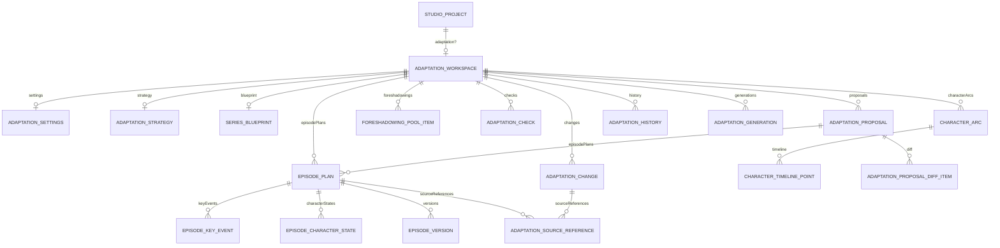
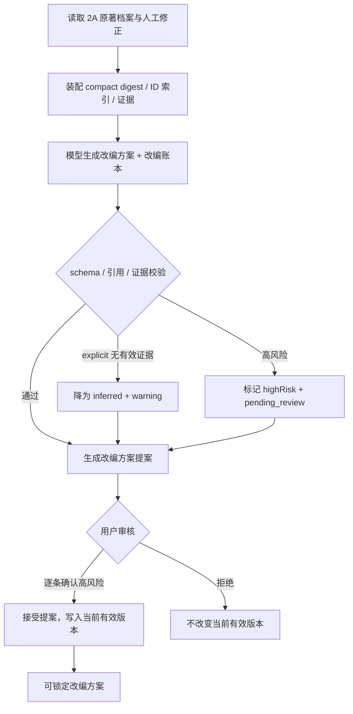
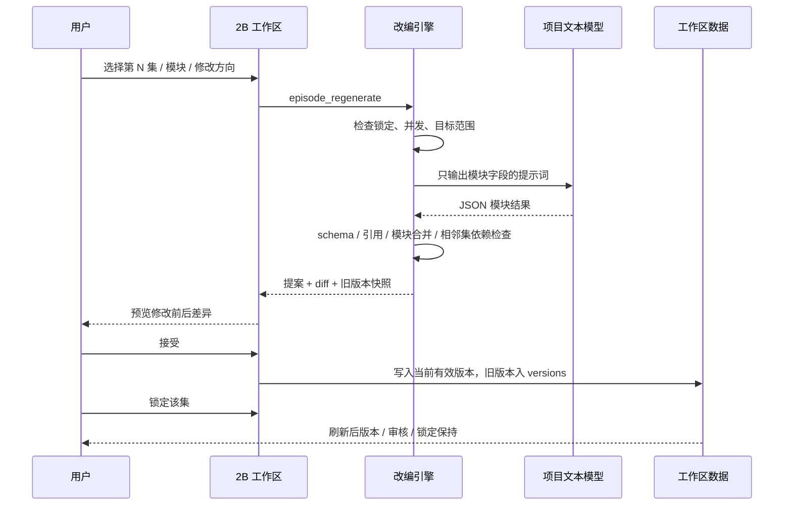

# 离火 AI 短剧工作室 · 阶段 2B 交付报告

> 范围：短剧化改编、全剧故事蓝图、一次性全剧分集规划、人物弧光与逐集记忆、伏笔池、剧情自检、审核与版本锁定、局部重生成，以及供阶段 3 使用的交接数据。
>
> 本阶段只到「完整分集规划」。不生成正式剧本对白、逐镜头分镜、角色图、场景图、九宫格或视频，不自动进入阶段 3。
>
> 当前状态：**2B 已实现并完成一轮真实小说浏览器验收，等待用户验收；未自动进入阶段 3。**

## 一、交付结论

| 项 | 结果 |
| --- | --- |
| 前置检查 | 已完成，报告见 `DRAMA_STUDIO_STAGE2B_PREFLIGHT.md` |
| 2A 两项 P1 修复 | 已完成并通过确定性测试：无效证据不再进入有效档案；项目级豆包 / Dola 账号不再回退全局账号 |
| 2B 数据模型 | 已完成，`StudioProject.adaptation` 最小增量扩展，没有另建项目根对象 |
| 2B 改编引擎 | 已完成：改编方案、全剧蓝图、全剧分集、综合人物 / 伏笔、局部重生成 |
| 2B 审核工作区 | 已完成：第一步内 8 个 2B 标签页，不新增第六步 |
| 唯一 AI 助手体验 | 已完成：用户只面对一个工作区；内部按阶段任务调用，共享同一项目上下文、蓝图和校验约束 |
| 真实小说验收 | 已完成项目 A `阶段2A验收·雾港夜航`（`proj-UORILWcK`）一轮真实浏览器验收 |
| 自动化测试 | `stage2b-core-check.ts`、`npm run typecheck`、`npm run build` 均通过 |
| 当前浏览器状态 | `3 集 × 60s / 审核进度 4/5 / 当前版本 v4 / 锁定 +1 集`；第 2 集待审核，第 3 集锁定 |
| 阶段 3 | 未启动，未生成剧本正文、分镜或视频 |

2A 的真实小说最终浏览器验收在 P1 修复后**没有重新跑完整一轮**；修复本身有确定性测试和真实数据回归，但这一点仍作为遗留风险记录在第十七节。

## 二、开工前置检查与 2A 承接

### 2.1 2A 最终状态

阶段 2A 已交付：

- TXT / DOCX / PDF / 粘贴四格式导入；TXT 编码识别、20 MB 上限、损坏文件明确报错。
- 章节识别、8,000 字分块、PDF 页范围映射。
- 真实项目级文本模型的结构化分析：人物、关系、世界观、地点、事件、伏笔。
- 逐字证据追溯、跨块合并去重、跨章校验、按有效证据计算完整度。
- 人工修正独立保存，重新分析不覆盖。
- 分析任务持久化、取消、失败分块重试、刷新中断恢复。

真实项目 A 当前档案：6 章 / 1,281 字；4 人物、4 关系、8 世界观、3 地点、6 事件、2 伏笔、70 条显式证据、1 处人工修正、6/6 章覆盖。

### 2.2 两项 P1 修复

| P1 | 修复结果 | 验证结果 |
| --- | --- | --- |
| 无效原著证据仍进入有效档案 | 证据摘录必须能在原文中规范化定位；空摘录、错误摘录、错误章节、跨章节摘录一律丢弃；`charStart` / `charEnd` 对应真实区间；无效证据不计入完整度 | valid 1 / whitespace 1 / wrong 0 / empty 0 / badChapter 0 / crossChapter 0 |
| 豆包 / Dola 项目账号缺失时可能继承全局账号 | 项目选择内置豆包 / Dola 文本模型时，项目账号为空、账号不存在、未登录、provider 不一致、状态异常、额度拒绝都在服务入口阻止；不回退全局号池、不自动换号 | `noProjectRejected true`、`validProject true`、`requestAccountId project-doubao`、`globalAccountUntouched true` |

另外落地的 2A 修复：超长章节按句子或自然边界分块并保留有限上下文重叠；PDF 空白页过滤后按有文本页重算章节页码范围。2A 修复检查：chunks 2 / max 7739；PDF 页码 1-3、3-3。

### 2.3 2A 数据结构是否足够

结论：**不足，必须做最小扩展，但不能改 `StudioEpisode` 语义。**

开工前 `StudioProject` 没有 2B 所需的改编定位、改编方案、全剧蓝图、分集规划、人物弧光、全剧伏笔池、校验结果、提案与版本、锁定状态。`StudioEpisode` 是阶段 3 的生产实体（剧本、镜头、素材等），不能把规划字段塞进去，否则会污染阶段 3 的正式输入。

最小扩展方案：

- 保留唯一项目根 `StudioProject`。
- 新增可选字段 `StudioProject.adaptation?: StudioAdaptationWorkspace`。
- 新增独立类型 `StudioEpisodePlan`，只承载「规划」，不承载阶段 3 的剧本与镜头。
- 旧项目通过 `normalizeStudioProject()` 补空值，不迁移、不删除旧数据。
- 2B 数据仍由 `storageKey("studio_store")` 持久化，不新建第二个短剧 store，不写全局 `AiConfig`。

## 三、产品定位与边界

2B 建立的是一个统一的 AI 短剧总编剧工作区：

- 用户只面对一个「短剧改编 · 2B」入口和一个审核工作区。
- 内部有 strategy / blueprint / episodeBatch / synthesis / regeneration 等阶段任务，但共享同一份项目级原著档案、项目级模型配置、改编定位、蓝图、人物弧光、伏笔池和校验结果。
- 2B 只负责规划，不负责生产素材。

本阶段明确不做：

- 正式剧本对白、逐镜头分镜、视频提示词。
- 角色图、场景图、九宫格、分镜图、视频。
- 自动进入第四步 / 第五步或阶段 3。
- 修改 Doubao / Dola Bridge、正式外部后端、`server/` 业务路由、无限画布核心、全局 `AiConfig`、全局豆包 / Dola 账号行为。
- 删除旧项目数据、自动提交或推送代码。

## 四、总体架构

```text
第一步 AI 小说分析
  ├─ 原著工作区（2A）：导入、章节、档案、证据、人工修正
  └─ 短剧改编 · 2B（同一第一步内切换）
       ├─ 改编定位
       ├─ 改编方案（可追踪 change ledger）
       ├─ 全剧蓝图
       ├─ 全剧分集规划（一次规划全部目标集数）
       ├─ 人物弧光 / 逐集人物状态
       ├─ 全剧伏笔池
       ├─ 剧情校验（error / warning / suggestion）
       ├─ 改编记录 / 版本 / 生成记录 / 阶段 3 交接
       └─ 提案 → 用户确认 → 当前有效版本 → 锁定
```

### 4.1 分层

| 层 | 文件 | 职责 |
| --- | --- | --- |
| 类型 | `web/src/types/studio-adaptation.ts` | 2B 数据契约；`StudioProject` 只新增可选 `adaptation` |
| 持久化 / 工作区 | `web/src/lib/studio/adaptation-workspace.ts` | 默认值、旧项目归一化、提案 diff、接受 / 拒绝、版本快照、锁定、审核进度、阶段 3 handoff、刷新恢复 |
| 校验 / 上下文 | `web/src/lib/studio/adaptation-schema.ts` | 2A 档案索引、schema 校验、引用校验、业务校验、人物弧光 / 伏笔同步、蓝图确定性补齐 |
| 提示词 | `web/src/lib/studio/adaptation-prompts.ts` | 2A 结构化档案 + compact digest + ID 索引 + 代表性原文证据；分阶段提示词 |
| 生成引擎 | `web/src/lib/studio/adaptation-engine.ts` | 分阶段调用、并发锁、取消、提案、局部重生成、相邻集依赖检查 |
| UI | `web/src/pages/drama/studio/adaptation/*` | 8 个审核标签页、提案预览、锁定、局部重生成、审核进度 |
| 入口 | `web/src/pages/drama/studio/analysis-workspace.tsx` | 在第一步内接入「短剧改编 · 2B」，可返回原著档案 |
| 样式 | `web/src/pages/drama/studio.css` | 2B 工作区样式，沿用现有设计 token |
| 测试 | `web/scripts/stage2b-core-check.ts` | 确定性模型 / 版本 / 锁定 / 交接测试 |

## 五、核心数据结构与关系

### 5.1 关系图



### 5.2 关键字段

```text
StudioProject
  └─ adaptation?: StudioAdaptationWorkspace
       ├─ settings
       │    genre / audience / platform / targetEpisodes / targetEpisodeSeconds
       │    narrativeStyle / tone / strength / endingDirection
       │    requirements / prohibitions
       ├─ strategy
       │    logline / positioningSummary / structureStrategy / characterStrategy
       │    conflictStrategy / foreshadowingStrategy / endingStrategy
       │    episodeCountPlan / changes / sourceAnalysisVersion / locked
       ├─ blueprint
       │    theme / logline / mainline / centralConflict / protagonistGoals
       │    antagonist / relationshipEvolution / stages / keyEvents
       │    climax / ending / foreshadowingPlan
       │    characters / relationships / locations / timeline
       │    version / reviewStatus / locked
       ├─ episodePlans[]
       │    episodeId / episodeNumber / episodeTitle / episodeLogline
       │    episodeSynopsis / dramaticGoal / openingHook / mainConflict
       │    keyEvents / characterAppearances / characterStates
       │    characterRelationshipChanges / locations
       │    emotionalProgression / climax / endingHook
       │    foreshadowingIntroduced / foreshadowingAdvanced / foreshadowingResolved
       │    continuityDependencies / estimatedDuration
       │    sourceReferences / adaptationChanges
       │    reviewStatus / version / locked / versions[]
       ├─ characterArcs[]
       │    initialState / coreGoal / innerConflict / flaw
       │    turningPoints / keyChoices / relationshipChanges / finalState
       │    milestones / timeline[]
       ├─ foreshadowings[]
       │    foreshadowingId / content / sourceType / sourceNovelForeshadowingId
       │    firstPlantedEpisode / advancedEpisodes / expectedResolveEpisode
       │    actualResolveEpisode / relatedCharacterIds / relatedEventIds
       │    status / isOriginal / isAiAdded / reviewStatus
       ├─ changes[]
       │    adaptationChangeId / operation / sourceType / sourceReferences
       │    beforeStructure / afterStructure / reason
       │    characterImpact / causalityImpact / foreshadowingImpact
       │    episodeNumbers / riskTags / highRisk / reviewStatus
       ├─ checks[] / proposals[] / history[] / generations[]
       └─ versionNumber / activeGenerationId
```

### 5.3 全剧记忆的数据落点

「全剧记忆」不是记住名字，而是每集逐人物保存：

```text
StudioEpisodeCharacterState
  characterId / name / location
  knows[] / unknown[]
  relationships / physicalState / abilityState / identityState
  present / lifeState
```

同时 `StudioCharacterArc.timeline` 保存同一人物逐集的地点、已知 / 未知信息、关系、身体 / 能力 / 身份状态、是否在场、生死状态。分集生成后由 `syncCharacterArcsFromPlans()` 从分集状态同步弧光时间线，避免模型只写一份“人物小传”而和分集脱节。

### 5.4 持久化与刷新恢复

- store 仍为 Zustand persist + localForage，键 `storageKey("studio_store")`。
- `partialize` 保存 `projects`、`migrationDone`；`merge` 逐项目 `normalizeStudioProject`。
- `factory.ts` 创建项目时初始化 `adaptation`；`setNovel` / `deleteNovel` 重置 `adaptation`，避免旧分析结果污染新原著。
- `normalizeStudioAdaptation()` 在恢复时把 `queued` / `running` 生成任务改成 `interrupted`，写入“未自动重发”，并清空 `activeGenerationId`。
- 刷新后当前有效版本、审核状态、锁定集数、提案与历史快照保留；运行中任务不会自动复活或重复计费。

## 六、改编定位与用户控制

第一步内「改编定位」支持：

- 短剧题材、目标受众、发布平台。
- 目标总集数、单集目标时长。
- 整体叙事风格、情绪基调。
- 改编强度：`faithful`（忠于原著）、`balanced`（平衡改编，默认）、`strong`（强化短剧）。
- 结局倾向。
- 用户特别要求和禁止事项。

目标集数与单集时长不是只保存的配置：

- `targetEpisodes` 进入分集生成目标、集数校验、全剧阶段范围校验、提案 diff 和阶段 3 handoff。
- `targetEpisodeSeconds` 进入分集提示词、`estimatedDuration` 校验（`episode_duration_mismatch` / `episode_duration_near`）。
- 修改定位后重新生成，必须体现在新提案；已锁定的改编方案、蓝图或分集不会被静默覆盖。

真实项目 A 的定位：

```text
题材：悬疑
受众：18-30 岁悬疑短剧用户
平台：抖音
目标总集数：3
单集时长：60 秒
改编强度：强化短剧
风格：冷峻悬疑、高密度反转
基调：压抑中带希望
结局：真相公开，苦尽甘来
特别要求：保留铜钥匙与旧钟楼；第 3 集回收铜钥匙发烫伏笔
```

保存后头部立即显示 `3 集 × 60s`，不再是旧默认的 12 集。

## 七、改编策略引擎

### 7.1 改编方案不是剧情摘要

AI 先阅读 2A 结构化档案（人物、关系、世界观、地点、事件因果、伏笔、证据），再生成独立改编方案。每条重要改编都进入 `changes` 账本：

- `adaptationChangeId`
- `operation`：`preserve` / `compress` / `merge` / `reorder` / `remove` / `add` / `rewrite`
- `sourceType`：`explicit` / `inferred` / `generated`
- 原著对应内容：章节、事件、场景、伏笔、原文证据
- `beforeStructure` / `afterStructure`
- `reason`
- 对人物、事件因果、伏笔的影响
- 关联集数
- 风险标签、`highRisk`、`reviewStatus`

### 7.2 原著事实、推断与 AI 新增严格区分

- `explicit`：原著明确事实，必须有能逐字定位的真实证据；没有有效证据的 `explicit` 自动降为 `inferred` 并产生 warning。
- `inferred`：基于原著的合理推断。
- `generated`：AI 为短剧效果新增的内容；不能携带原著证据伪装成事实，携带了会被提示并按新增内容处理。

### 7.3 高风险改编

以下内容必须标记 `highRisk` 并要求用户逐条审核：

- 主角身份改变。
- 核心人物死亡、生存状态改变。
- 重要人物关系改变。
- 关键事件删除。
- 世界观规则改变。
- 核心伏笔删除或改变。
- 故事结局改变。
- 主要人物动机重大改变。

真实项目 A 的改编方案有 4 条改编：2 条 `merge` 原著明确、1 条 `rewrite` 高风险、1 条 `add` AI 新增高风险。逐条确认高风险后才允许通过方案。

### 7.4 改编引擎流程



## 八、全剧故事蓝图

蓝图是全部分集共享的最高层剧情依据，包含：

- 全剧核心主题、一句话故事、故事主线、主要矛盾。
- 核心人物目标、主要反派及动机、主要人物关系演变。
- 全剧主要阶段、关键事件顺序、全剧高潮、故事结局。
- 重要伏笔及回收安排、人物出场 / 退场安排、主要地点使用安排、故事时间线。

每个蓝图关键事件必须关联 2A 原著事件 ID，或明确标记为 AI 新增事件；不允许把新增事件伪装成原著事实。

蓝图有版本号、创建时间、审核状态、锁定状态；锁定后重新生成被拒绝，必须先解锁。

真实项目 A 蓝图：

```text
阶段：
  迷雾入局（1-1）
  记忆觉醒（2-2）
  归航兑现（3-3）

关键事件：
  钟楼突袭抢夺（第 1 集，原著明确）
  第七声钟启航道（第 2 集，原著明确）
  夜航归港（第 3 集，原著明确）

人物：4 人；关系：4 条；地点：3 个；时间线：已生成
```

### 8.1 关于“模型截断后确定性补齐”的说明

真实调用暴露了一个不能靠 JSON 解析器解决的问题：让模型同时输出蓝图核心 + 人物 / 关系 / 地点 / 时间线时，模型在 `"characters":` 处稳定截断。两次重试分别只输出 4,197 字符和 15 字符；这不是普通 JSON 语法错误。

为了不修改 Doubao / Dola Bridge，最终改为：

- 蓝图模型只输出核心编剧判断：主题、一句话、主线、矛盾、阶段、关键事件、高潮、结局、伏笔安排。
- 人物、关系、地点、时间线由 `completeSeriesBlueprintFromAnalysis()` 基于 2A 的真实人物、关系、地点、阶段和事件 `episodeHint` 确定性补齐。

这不是“AI 假装生成了人物设定”：补齐只使用 2A 已审核档案，不制造新事实；模型仍负责改编方案和关键事件等真正的编剧判断。

## 九、全剧分集规划

### 9.1 一次性规划全部目标集数

默认一次生成全部目标集数，不存在“先写前几集、以后再续”的产品默认。

每集包含 26 项规划字段：

- `episodeId` / `episodeNumber` / `episodeTitle` / `episodeLogline` / `episodeSynopsis`
- `dramaticGoal`：本集戏剧目标（新增）
- `openingHook` / `mainConflict` / `keyEvents`
- `characterAppearances` / `characterStates` / `characterRelationshipChanges`
- `locations` / `emotionalProgression` / `climax` / `endingHook`
- `foreshadowingIntroduced` / `foreshadowingAdvanced` / `foreshadowingResolved`
- `continuityDependencies` / `estimatedDuration`
- `sourceReferences` / `adaptationChanges`
- `reviewStatus` / `version` / `locked` / `versions[]`

### 9.2 硬约束

- 每集必须推动全剧主线或重要人物成长。
- 每集必须有清晰戏剧目标（`episode_without_goal` 为 error）。
- 每集必须有核心冲突、高潮（为 error）。
- 开场钩子、集尾钩子、地点缺失为 warning。
- 相邻集必须有时间、地点、人物状态、事件因果承接说明。
- 集数总量必须等于目标；缺集 / 多集 / 数量不一致均为 error。
- 不允许复制同一段摘要填满集数（`duplicate_episode_synopsis` 为 error）。
- 不允许重复关键事件（`duplicate_key_event` 为 warning）。
- 每集都要有原著来源或 AI 新增标记。

### 9.3 真实项目 A 当前 3 集

| 集 | 标题 | 时长 | 戏剧目标 / 关键状态 |
| --- | --- | --- | --- |
| 1 | 雾钟授钥 | 60s | 交付铜钥匙，抛出夜航失踪悬念，建立顾北与主角团对立 |
| 2 | 钟醒归航 | 60s | 货仓对峙顾北自白罪行，林舟逃脱返回钟楼，解锁船牌恢复记忆，第七声钟裂开旧航道入口 |
| 3 | 夜航归港 | 60s | 回收铜钥匙发烫伏笔，唤醒船员，真相公开，完成夜航归航闭环 |

第 3 集已锁定；第 2 集在局部重生成后为待审核；审核进度 4/5。

### 9.4 全剧规划生成流程


## 十、全剧记忆：人物弧光与逐集状态

### 10.1 人物弧光

为每个主要人物保存：

- 初始状态、核心目标、内在矛盾、人物缺陷。
- 重要转折、关键选择、人物关系变化、最终状态。
- `milestones`：首次出场、退场、死亡、回归、身份揭露、转折、选择。
- `timeline`：逐集地点、知道 / 不知道、关系、身体 / 能力 / 身份、是否在场、生死 / 失踪状态。

真实项目 A 有 4 条人物弧光：林舟、沈鸢、老周、顾北；每人 3 集状态，包含初始 / 最终状态、核心目标、内在矛盾。

### 10.2 防止“人物提前知道秘密”

校验会检查同一人物在后续集的 `unknown` 是否与前面已经 `knows` 的事实冲突。例如人物在第 4 集已经知道某个秘密，第 6 集仍被标为不知道，会产生 error `character_knows_too_early`，并指出集数、人物和事实。

### 10.3 出场、退场、死亡与回归

- 人物出场但缺少逐集状态 → warning `missing_character_state`。
- 已死亡人物再次作为在场角色出现且缺少回归依据 → error `character_returns_without_basis`。
- 首次出场、退场、死亡、回归、身份揭露都进入 `milestones`，并要求有来源或明确标注为 AI 新增。

### 10.4 三项“真正有价值的能力”落点

| 能力 | 落点 | 不只是什么 |
| --- | --- | --- |
| 全剧记忆 | `episodePlans[].characterStates` + `characterArcs[].timeline` + `syncCharacterArcsFromPlans()` | 不是只记住人物名字；每一集都知道人物在哪、知道什么、与谁什么关系、身体 / 能力 / 生死状态 |
| 编剧判断 | 改编方案（改编操作 + 原因 + 影响）、蓝图（阶段 / 关键事件 / 高潮 / 结局）、分集戏剧目标 / 冲突 / 钩子 | 不是按章节机械拆分；目标集数、时长、改编强度、受众和平台都进入提示词与校验 |
| 逻辑自检 | `adaptation-schema.ts` 的确定性检查 + 模型自检 + 逐条问题定位 | 不是生成后只显示“成功”；会明确指出第几集、哪个人物、哪个事件 / 地点发生了什么矛盾 |

## 十一、剧情因果与时间线校验

### 11.1 校验级别

- `error`：必须修复的逻辑冲突。
- `warning`：需要人工确认的风险。
- `suggestion`：优化建议。

AI 不自动改写全部检查结果。用户可以查看问题、接受建议、忽略、标记已解决，或按建议局部重生成。

### 11.2 已覆盖的确定性检查

| 类别 | 代表检查 |
| --- | --- |
| 集数 | 缺集 / 多集 / 数量不一致 / 分集重复摘要 / 重复关键事件 |
| 分集质量 | 缺剧情概要、缺戏剧目标、缺核心冲突、缺高潮、缺开场钩子、缺集尾钩子、缺地点、时长偏差 |
| 人物连续性 | 出场无状态、在场无地点、死亡后无依据回归、提前知道秘密、弧光初始 / 最终缺失、弧光时间线缺口 |
| 时间线 / 移动 | 相邻集地点变化但没有移动说明（`location_change_without_move`）、上一集连续性依赖缺失（`episode_without_continuity`） |
| 事件因果 | `explicit` 事件无有效原著证据、关键事件重复、每集无关键事件 |
| 伏笔 | 首次埋设 / 回收顺序、回收早于埋设、标为已回收但无回收动作、原著伏笔未关联源 ID、分集引用不在伏笔池 |
| 改编 | 高风险未审核、`explicit` 改编无证据、`generated` 改编携带原著证据、改编未映射到任何分集、缺少改编原因 |
| 蓝图 | 缺主题 / 一句话 / 主线 / 矛盾 / 关键事件 / 高潮 / 结局、阶段范围不合法、阶段未覆盖全部集数 |

### 11.3 真实项目 A 的检查结果

```text
0 error / 8 warning / 1 suggestion / 待处理 9
```

典型 warning 是真实可定位的：

- 林舟第 1 集在「旧钟楼，后被带往货仓」，第 2 集在「船帮货仓→旧钟楼」，没有说明移动过程。
- 沈鸢第 1→2、2→3 集，老周第 2→3 集，顾北第 1→2、2→3 集同类地点移动问题。
- 第 1 集没有连续性依赖说明（`episode_without_continuity`）。
- `change_not_in_episode` 等 suggestion 提示某条改编记录没有映射到任何分集。

这些 warning 不会被 AI 静默改掉。它们保留在「剧情校验」页，用户可按级别、集数、人物筛选，逐条接受 / 忽略 / 解决，或按建议重生成相关集。

## 十二、伏笔与悬念管理

### 12.1 全剧统一伏笔池

每条伏笔包含：

- `foreshadowingId`
- 内容 / 来源
- 首次埋设集数
- 推进集数
- 预计回收集数 / 实际回收集数
- 关联人物 / 关联事件
- 当前状态
- 是否原著伏笔 / 是否 AI 新增
- 审核状态

状态：`planned` / `planted` / `advancing` / `resolved` / `abandoned` / `pending_review`。

### 12.2 不允许“假回收”

- 标为 `resolved` 但实际回收集为空、首次埋设缺失，或回收集没有回收动作 → error `foreshadowing_resolved_without_payoff` / `foreshadowing_false_resolved`。
- 预计回收早于首次埋设 → error。
- 同一伏笔在多个集标记回收但实际回收集冲突 → error。
- 原著伏笔没有关联 2A 源伏笔 ID → warning；如果声称是原著伏笔却没有源 ID，不允许当作已核实原著伏笔。

### 12.3 真实项目 A 的伏笔池

| ID | 内容 | 来源 | 埋设 | 推进 | 预计 / 实际回收 | 状态 |
| --- | --- | --- | --- | --- | --- | --- |
| `fore-001` | 第七声钟 | 原著 | 1 | 2 | 2 / 2 | resolved |
| `fore-002` | 航海日志 | 原著 | 1 | 2 | 3 / 3 | resolved |
| `fore-003` | 铜钥匙发烫 | AI 新增 | 1 | 2 | 3 / 3 | resolved |

`fore-001` / `fore-002` 是原著伏笔，`fore-003` 是 AI 新增；三者都在分集里有埋设 / 推进 / 回收记录，且用户特别要求在第 3 集回收铜钥匙发烫伏笔已落地。

## 十三、局部重生成与版本控制

### 13.1 提案机制

所有生成都先产出 `StudioAdaptationProposal`，不直接覆盖当前有效版本：

```text
生成 → 提案（diff / 基础版本 / 目标集数）→ 用户预览
  ├─ 拒绝 → 当前有效版本不变
  └─ 接受 → 写入当前有效版本，versionNumber + 1
```

- 提案保存整包快照或局部变更。
- `history` 保存整包快照；`episodePlans[].versions` 保存单集旧稿（最多 5 版）。
- 接受单集变更时，旧版本写入 `versions`，并记录修改原因、时间、旧标题 / 旧冲突等。
- 提案 diff 逐字段比较：剧集标题、logline、剧情概要、戏剧目标、开场钩子、核心冲突、关键事件、人物出场、人物状态、关系变化、地点、情绪推进、高潮、集尾钩子、伏笔、连续性、时长、原著依据、改编记录。每个变化字段显示前后值（截断 160 字）。
- 只对 `targetEpisodeNumbers` 范围内判断“移除集数”；不再把未包含的相邻集误报为删除。

### 13.2 锁定

- 可锁定改编方案、全剧蓝图、单集或多集。
- 锁定的内容不被重新生成覆盖；`applyProposalToWorkspace()` 和 `mergeEpisodePlans()` 都跳过 locked 项。
- 目标集全部锁定时生成被拒绝：`all_locked`。
- 锁定前检查高风险改编是否逐条确认；未确认不能锁定。

### 13.3 局部重生成

支持：

- 单集重新生成。
- 连续多集重新生成。
- 单集指定模块重生成：`synopsis`（剧情概要 / 戏剧目标）、`conflict`（核心冲突 / 高潮）、`characters`（人物出场 / 状态 / 关系）、`hooks`（开场 / 集尾钩子）、`foreshadowing`（伏笔埋设 / 推进 / 回收）。
- 用户填写修改方向；锁定集不会被覆盖。

局部重生成后额外检查：

- 当前集是否说明了如何承接上一集（`regen_missing_previous_dependency`）。
- 下一集是否仍依赖修改前的当前集，但没有写明依赖（`regen_next_dependency`）。
- 当前集集尾钩子变化、下一集没有连续性说明（`regen_hook_changed_next`）。

### 13.4 真实项目 A 的第 2 集局部重生成

第 2 集「核心冲突 / 高潮」模块重生成连续失败两次：模型在约 4.7k 字符处截断（界面显示已收到 4,679 / 4,693 字符）。原因是模块提示词要求输出完整 episode 对象再只取模块，输出过大且 Bridge 容易截断。

改为模块提示词只输出当前模块字段，其他字段沿用当前集后，第三次真实调用成功：

```text
输入：18,993 字符，1 次调用
提案：第 2 集「核心冲突 / 高潮」局部重生成提案
基础版本：v3
```

| 字段 | 修改前 | 修改后 |
| --- | --- | --- |
| 核心冲突 | 顾北的罪行被撞破，林舟要找回自己身份、探明夜航真相 | 顾北坦白当年为私货强行出港、关闭安全锁，林舟要守住钥匙、查清真相，顾北要灭口夺证掩盖全部罪责 |
| 高潮 | 林舟看见刻名船牌，恢复夜航引航员身份记忆 | 林舟看见刻名船牌恢复引航员记忆，知晓顾北不止强令出港，还锁死第六声钟防护，致使夜航坠入旧航道 |

接受后：

- 当前版本 `v4`。
- 第 2 集 `版本 v2`，`历史版本（1）`；旧版本 `v1`，修改原因“让顾北在货仓对峙时说出当年夜航的更多内情，增加冲突层次”。
- 第 2 集回到 `pending_review`；第 3 集保持锁定，没有被覆盖。
- 审核进度 `4/5`。
- `history` 有 4 个确认快照：v3 第 2 集局部重生成、v2 全剧分集规划、v1 全剧蓝图、v0 改编方案。
- 生成记录：15:48 `1 次调用 · 18,993 字符 · 输入版本 v3 → v4 · 已完成`。

### 13.5 局部重生成时序



## 十四、用户审核工作区

第一步内新增 8 个标签页，不新增第六步：

| 标签 | 能力 |
| --- | --- |
| 改编定位 | 题材、受众、平台、集数、时长、风格、基调、强度、结局、要求 / 禁止 |
| 改编方案 | 方案正文、改编账本、原著证据、高风险逐条审核、锁定 |
| 全剧蓝图 | 主题 / 一句话 / 主线 / 矛盾 / 阶段 / 事件 / 高潮 / 结局 / 人物 / 关系 / 地点 / 时间线，编辑、通过、锁定 |
| 分集规划 | 全剧集数、按集筛选、连续多集重生成、单集编辑 Drawer、模块重生成、锁定、历史版本 |
| 人物弧光 | 4 人物 × 3 集状态时间线、初始 / 最终、目标 / 矛盾 / 缺陷、编辑 |
| 伏笔管理 | 全剧伏笔池、埋设 / 推进 / 回收、原著 / AI 新增、状态编辑 |
| 剧情校验 | `error / warning / suggestion` 汇总、按级别 / 集数 / 人物筛选、接受 / 忽略 / 解决、按建议重生成 |
| 改编记录 | 提案 diff、接受 / 拒绝、改编差异账本、版本历史、生成记录、阶段 3 交接摘要 |

界面顶部固定展示：`3 集 × 60s`、当前分集数、审核进度、当前版本、锁定状态、项目文本模型、阶段 2B 标记。生成中 / 失败 / 待审核 / 已锁定使用不同状态标签；长文本使用折叠面板、Drawer 和分栏，不堆成巨型页面。

入口行为：在第一步「AI 小说分析」工作区内点击「短剧改编 · 2B」切换为 2B 工作区，可返回原著档案；阶段 3 仍从五步导航进入，不因 2B 出现第六步。

## 十五、阶段 3 的数据交接

`adaptationHandoff()` 只输出当前有效版本，不消费提案草稿：

```ts
type StudioAdaptationHandoff = {
    projectId: string;
    analysisVersion: number;
    blueprintId: string;
    blueprintVersion: number;
    packageVersion: number;
    episodePlans: StudioEpisodePlan[];
    characterArcs: StudioCharacterArc[];
    foreshadowings: StudioForeshadowingPoolItem[];
    changes: StudioAdaptationChange[];
    lockedEpisodeNumbers: number[];
    lockedBlueprint: boolean;
};
```

阶段 3 会拿到：

- 全剧蓝图引用与版本。
- 当前有效分集版本。
- 分集关键事件。
- 人物及关系状态、逐集记忆。
- 场景引用。
- 伏笔安排。
- 事件因果依赖。
- 原著证据引用。
- 改编记录。
- 用户锁定状态。

当前项目 A 交接摘要：`当前包版本 v4 / 分集规划 3 集 / 人物弧光 4 / 伏笔池 3 / 锁定集 1`。

本阶段没有生成正式剧本对白、逐镜头分镜或视频提示词；这些仍是阶段 3 的工作。

## 十六、模型调用链与成本控制

### 16.1 只使用项目级文本模型

- 入口：`novelTextModelRuntime(project)`。
- 调用：`requestNovelText(runtime, messages, { ...requestOptions(runtime), signal })`。
- 项目模型真实写入 `StudioProject.modelProfiles`；模型标签为项目 A 的「对话（豆包）」、账号 `db-mvxvft3x-a9tky`。
- 不读取、不修改全局 `AiConfig`；不改变全局豆包 / Dola 账号行为。
- 项目账号缺失 / 未登录 / provider 不一致时在 2A 的模型运行时直接阻止，2B 不会绕过。

### 16.2 不重复发送整本小说

输入上下文按阶段装配：

| 阶段 | 上下文上限 | 内容 |
| --- | --- | --- |
| strategy | 24,000 字符 digest | 2A 结构化档案、章节 / 人物 / 事件 / 场景 / 伏笔 ID 索引、代表性原文证据、改编定位 |
| blueprint | 22,000 字符 digest | 同一档案 + 已确认改编方案 + 改编账本 + 当前伏笔池 |
| episodeBatch | 18,000 字符 digest | 蓝图、改编方案、目标集数、前序集摘要、当前集人物 / 伏笔约束 |
| synthesis | 12,000 字符 digest | 已生成分集摘要、伏笔池、人物弧光缺口 |
| episode_regenerate | 14,000 字符 digest | 当前集、相邻集摘要、锁定集、伏笔池、修改原因 |
| episodeModule | 当前集 + 相邻摘要 + 模块 schema | 只要求模型输出当前模块字段，其他字段沿用当前集 |

- `buildAdaptationSourceDigest()` 使用结构化摘要，不把整本小说无差别重复发送。
- 提示词带真实 ID 索引和必要证据；模型不能编造不存在的 chapter / character / scene / event / foreshadowing ID。

### 16.3 分阶段任务

- `full`：strategy → blueprint → episode batches → synthesis → deterministic validate。
- `strategy`、`blueprint`、`episodes`、`episode_regenerate` 可单独运行。
- `episode_regenerate` 支持整集或模块。
- 没有“先写几集、以后再临时续写”的默认行为；目标集数一次规划完整。

### 16.4 预算与真实调用

`estimateAdaptationCalls()`：

- strategy：1 次。
- blueprint：1 次。
- episodes：1 + 批次（每批 1 集）。
- full：3 + 批次（strategy + blueprint + synthesis + 分集批次）。
- episode_regenerate：1 次。

目标 3 集的 full 预算为 `3 + 3 = 6` 次；模型若一次返回多集并覆盖全部目标，`ensureEpisodeBatch()` 会接受并提前结束后续批次，因此成功路径可能少于预算。

真实任务审计：

| 任务 | 结果 |
| --- | --- |
| `job-mwrhl33n-d69w` | 改编方案成功，7,021 字符 |
| `job-mwrhotlh-bc17` | 蓝图首次截断，4,197 字符，末尾 `"characters":` |
| `job-mwri28uc-pmai` | 压缩蓝图仍截断，15 字符 |
| `job-mwri1btg-yg9q` | 分两阶段蓝图核心成功 |
| `job-mwricr6h-b86a` | 分集一次返回全部 3 集，15,448 字符 |
| 15:48 模块重生成 | 1 次调用，18,993 字符，v3 → v4 成功 |

最终三阶段蓝图成功任务、以及第 2 集模块前两次失败任务的 job id 未在界面记录，可从 Bridge `/api/jobs` 复核。

### 16.5 可靠性保护

- `activeByProject` 内存锁：同一项目同时只允许一个生成任务，重复提交直接抛出 `duplicate_generation`。
- 支持取消；取消后状态 `canceled`，不写半成品。
- 失败重试由用户手动触发；`unknown` 状态不自动重发。
- 刷新恢复把 `queued / running` 改为 `interrupted`，清空 `activeGenerationId`，不会自动重发或重复计费。
- 生成记录保存模型、参数、输入版本、输出提案、调用次数、输入字符、prompt hash、目标集数、锁定集数。
- 解析器 `parseJson()` 从首个 `{` 做字符串感知括号配对；找不到根对象闭合时抛出明确 `json_truncated`，不再误报普通 JSON 语法错误。
- schema 通过不等于剧情合理：JSON 解析成功后仍必须通过引用校验、证据校验和业务规则校验，才生成提案。

## 十七、自动化测试与真实小说浏览器验收

### 17.1 自动化测试

已执行：

```bash
cd C:\Users\qq308\Desktop\lihuo\web
npx --yes tsx scripts/stage2b-core-check.ts
npm run typecheck
npm run build
```

结果：

- `stage2b-core-check.ts`：通过。
- `npm run typecheck`：通过，exit 0。
- `npm run build`：通过；Vite 8285 modules，index 4,549.92 kB，built in 1m 18s；仅有既有 chunk 体积和动态 / 静态混合导入 warning。

`stage2b-core-check.ts` 输出：

```json
{
  "plans": 3,
  "targetEpisodes": 3,
  "characterArcTimeline": 3,
  "originalForeshadowings": 1,
  "reconciledForeshadowingStatus": "advancing",
  "errors": 5,
  "warnings": 12,
  "suggestions": 1,
  "lockedEpisodePreserved": true,
  "proposalDiffRemoved": 0,
  "proposalDiffChanged": [1, 3],
  "savedVersionReason": "验证锁定保护",
  "handoffEpisodes": 3,
  "handoffLocked": [1],
  "restoredStatus": "interrupted"
}
```

说明：测试夹具故意包含 5 个 error 场景（缺集 / 人物提前知道秘密 / 伏笔假回收等）以验证校验器能报出来；这不是测试失败。`lockedEpisodePreserved true` 验证锁定集不被提案覆盖；`proposalDiffRemoved 0` 验证不再误报未包含的相邻集为删除；`restoredStatus interrupted` 验证刷新恢复不自动重发。

### 17.2 真实小说项目 A 验收流程

项目 A：`proj-UORILWcK` / `阶段2A验收·雾港夜航` / 6 章 / 1,281 字；模型「对话（豆包）」；账号 `db-mvxvft3x-a9tky`；Bridge `http://127.0.0.1:9091`；前端 `http://localhost:3000`。

| 验收项 | 实际结果 |
| --- | --- |
| 用户修改改编定位后，生成结果体现修改 | 改为 3 集 × 60s、悬疑、抖音、强化短剧等；保存后头部 `3 集 × 60s`，后续方案 / 蓝图 / 分集均按此生成 |
| 改编方案区分原著事实与 AI 新增 | 4 条改编：2 条 merge 原著明确、1 条 rewrite 高风险、1 条 add AI 新增高风险；逐条显示来源与风险 |
| 重大改编有明确审核提示 | 2 条高风险未确认时不能通过 / 锁定；逐条确认后才可接受提案 |
| 全剧蓝图完整 | 3 阶段、3 关键事件、4 人物、4 关系、3 地点、时间线、高潮、结局、伏笔安排完整 |
| 分集数量与目标一致 | 目标 3 集，生成 3 集 ep-001 / ep-002 / ep-003 |
| 每集有独立剧情目标和核心冲突 | 每集 `dramaticGoal` / `mainConflict` / `climax` / `endingHook` 齐全 |
| 人物弧光连贯 | 4 人 × 3 集状态；`syncCharacterArcsFromPlans()` 生成逐集时间线 |
| 人物出场和状态连续 | `characterStates` 含地点 / 知道 / 不知道 / 关系 / 身体 / 能力 / 身份 / 在场 / 生死 |
| 时间线没有明显矛盾 | 无 error；8 条 warning 集中在地点移动说明与第 1 集连续性依赖，已可定位、可处理 |
| 关键事件合理因果 | 第 1 集钟楼抢夺 → 第 2 集第七声钟启航道 → 第 3 集夜航归港；每集 `continuityDependencies` 承接前集 |
| 伏笔埋设和回收可追踪 | 3 条伏笔均记录埋设 / 推进 / 预计 / 实际回收集数和状态 |
| 局部重生成不覆盖锁定内容 | 第 3 集锁定；第 2 集模块重生成接受后第 3 集仍锁定、未被覆盖 |
| 修改一集后检查相邻集依赖 | 局部重生成触发 `validateNeighborDependencies()`，检查第 1 / 3 集承接与旧版事件依赖 |
| 刷新后规划和审核状态保留 | 刷新后仍为 `3 集 × 60s / 4/5 / v4 / 锁定 +1 集` |
| 项目之间数据隔离 | 项目 B `proj-iNU-UIPW` 打开仍为「草稿」，只有 2A 导入与「开始原著分析」，无 2B 入口、无项目 A 的 2B 数据 |
| 项目模型配置真实生效 | 项目 A 使用项目级「对话（豆包）」；2B 生成记录带模型、参数、调用数与字符数 |
| 原有五步导航 / 旧 V2 项目 / 无限画布正常 | 五步导航在 2A / 2B 均正常；`/canvas` 正常打开且无 fatal error；旧 V2 项目 `阶段1验收·雾港回声` 在项目库正常显示 |

### 17.3 关键验收截图

- `docs/ai-handover/stage2b-persist-v4.png`：刷新后 `3 集 × 60s / 4/5 / v4 / 锁定 +1 集`。
- `docs/ai-handover/stage2b-regen-diff.png`：第 2 集核心冲突 / 高潮逐字段差异。
- `docs/ai-handover/stage2b-regen-version-history.png`：第 2 集 Drawer 历史版本 v1 与旧冲突。
- `docs/ai-handover/stage2b-checks-detail.png`：剧情校验汇总与林舟地点移动 warning。
- `docs/ai-handover/stage2b-project-b-isolation.png`：项目 B 草稿、无 2B 入口。
- `docs/ai-handover/stage2b-episodes-approved.png`：3 集 / 审核 5/5 / v3 的完整头部。
- `docs/ai-handover/stage2b-regen-proposal.png`：局部重生成提案预览。
- `docs/ai-handover/stage2b-regen-failed.png`：模块重生成失败提示（暴露截断问题）。
- `docs/ai-handover/stage2b-episode2-drawer.png` / `stage2b-module-select.png`：第 2 集编辑与模块选择。

### 17.4 浏览器自动化注意

本次验收使用独立自动化标签打开 `http://localhost:3000/drama`，未关闭用户原标签 `e3e460b3-6688-482c-8b6f-d939a9743b9e`；自动化标签 targetId `67c93439-9e53-439d-94b6-75a2ea7b9a1b`。

已知观察陷阱（不是产品 bug）：

- HMR 后 `.studio-workspace-page` 的入场动画可能停在 `opacity: 0`，截图前对内联设置 `animation: none; opacity: 1` 即可恢复；DOM 文本与点击正常。
- AntD Drawer 在 718×667 视口下动画可能停在右侧，需内联 `transition: none; transform: none; opacity: 1`。
- 内容布局宽 960，100% 截图会横向裁切；临时 `body.zoom = 0.75` 可完整截取头部，截图后恢复。

## 十八、文件修改清单

### 18.1 2B 源代码净增量

与 `stage2b-baseline` 对照，`web/src` + `web/scripts` 共 22 个文件、5,872 行新增 / 1 行删除：

| 文件 | 变更 |
| --- | --- |
| `web/src/types/studio-adaptation.ts` | 新增 519 行，2B 核心契约 |
| `web/src/lib/studio/adaptation-workspace.ts` | 新增 586 行，默认值 / 归一化 / 提案 / 版本 / 锁定 / handoff |
| `web/src/lib/studio/adaptation-schema.ts` | 新增 1,301 行，schema / 引用 / 业务校验 / 蓝图补齐 |
| `web/src/lib/studio/adaptation-prompts.ts` | 新增 447 行，分阶段提示词 |
| `web/src/lib/studio/adaptation-engine.ts` | 新增 707 行，生成编排 / 取消 / 提案 / 局部重生成 |
| `web/src/pages/drama/studio/adaptation/shared.tsx` | 新增 66 行 |
| `web/src/pages/drama/studio/adaptation/settings-tab.tsx` | 新增 69 行 |
| `web/src/pages/drama/studio/adaptation/strategy-tab.tsx` | 新增 138 行 |
| `web/src/pages/drama/studio/adaptation/blueprint-tab.tsx` | 新增 116 行 |
| `web/src/pages/drama/studio/adaptation/episodes-tab.tsx` | 新增 235 行 |
| `web/src/pages/drama/studio/adaptation/characters-tab.tsx` | 新增 103 行 |
| `web/src/pages/drama/studio/adaptation/checks-tab.tsx` | 新增 80 行 |
| `web/src/pages/drama/studio/adaptation/foreshadowing-tab.tsx` | 新增 81 行 |
| `web/src/pages/drama/studio/adaptation/records-tab.tsx` | 新增 74 行 |
| `web/src/pages/drama/studio/adaptation/index.tsx` | 新增 579 行，2B 主工作区 |
| `web/src/lib/studio/factory.ts` | +6 / -1，创建并归一化 adaptation |
| `web/src/pages/drama/studio/analysis-workspace.tsx` | +7，接入 2B 入口与切换 |
| `web/src/pages/drama/studio.css` | +223，2B 样式 |
| `web/src/stores/use-studio-store.ts` | +15，updateAdaptation / 重置 adaptation |
| `web/src/types/studio.ts` | +3，StudioProject 可选 adaptation |
| `web/scripts/stage2b-core-check.ts` | 新增 504 行，确定性测试 |
| `web/scripts/stage2b-local-storage-stub.ts` | 新增 14 行，Node 测试 localStorage 垫片 |

### 18.2 文档与验收资产

- 新增 `docs/ai-handover/DRAMA_STUDIO_STAGE2B.md`（本报告）。
- 新增 `docs/ai-handover/DRAMA_STUDIO_STAGE2B.diff`（净增量 Diff）。
- 已有 `docs/ai-handover/DRAMA_STUDIO_STAGE2B_PREFLIGHT.md`（前置检查报告）。
- 更新 `CHANGELOG.md`、`docs/content/docs/progress/todo.mdx`、`docs/content/docs/progress/pending-test.mdx`。
- 更新 `docs/ai-handover/ENTRY_POINTS.md`、`ARCHITECTURE.md`、`KNOWN_ISSUES.md`。
- 新增 15 张 `docs/ai-handover/stage2b-*.png` 验收截图。

### 18.3 明确未修改

- 未修改 `doubao-bridge/` 的 Bridge 行为。
- 未修改正式外部后端。
- 未修改仓库 `server/` 业务路由。
- 未修改无限画布核心。
- 未修改全局 `AiConfig`。
- 未修改豆包 / Dola 全局账号行为。
- 未删除旧项目数据。
- 未自动提交或推送代码。
- 未新增第六步导航。
- 未生成角色图、场景图、九宫格、分镜或视频。

## 十九、Git 差异与既有修改保护

- 分支 `main`；2B 开工前 HEAD `27b67bd09a8aead582868e139c585b7ba4b03b0e`。
- 开工前 `git status --short` 记录 147 条既有修改 / 未跟踪文件。
- 本轮结束时 `git status --short` 为 166 行；增量主要来自 2B 源文件、报告、Diff 与截图。
- 未执行 `git reset` / `git checkout` / `git stash` / `git clean`，未回滚、覆盖、删除任何既有未提交改动。
- 未自动提交、未自动推送、未打 tag。
- 2B 净增量以 `stage2b-baseline` 为参照，只对 `web/src` 与 `web/scripts` 逐文件比较；baseline 未覆盖 `web/public`、`web/dist`、`web/package.json` 等，不能用全目录 diff 直接判断为 2B 新增。
- 完整代码 Diff 见 `docs/ai-handover/DRAMA_STUDIO_STAGE2B.diff`。

基线目录：

```text
C:\Users\qq308\AppData\Local\Doubao\User Data\Profile 3\.doubao\agent_mode\workspace\.sessions\38454513883379714\agents\m_0cwediOGgIg\stage2b-baseline
```

## 二十、尚未完成事项与风险

### 20.1 2A 遗留

1. **2A P1 修复后的真实浏览器最终验收未重跑**：修复有 `stage2a-fix-check.ts` 覆盖和真实数据回归，但完整 2A 浏览器流程仍需用户最终确认。
2. **2A 真实模型累计约 11 次调用**：仍在当时限定范围内；2B 另有真实调用，未做全量成本汇总。

### 20.2 模型可靠性

3. **Blueprint 截断不是 Bridge 代码 bug**：目前通过“只让模型生成蓝图核心 + 2A 档案确定性补齐”绕过；如果模型仍截断核心字段，生成会失败并保留错误，不写半成品。没有自动重试，避免重复计费。
4. **模块重生成截断**：已改为只输出模块字段，真实成功一次；但长模块 / 弱模型仍可能截断，需用户重试或缩小修改方向。
5. **模型输出仍需人工审核**：schema 通过只代表结构合法，不代表剧情合理；高风险改编、warning、人物状态、伏笔回收都必须人工确认。

### 20.3 规模与性能

6. **真实项目 A 只有 3 集 / 1,281 字**：没有验证 20 集、50 集、120 集长剧；`ADAPTATION_MAX_EPISODES = 120` 是硬上限，不是已验证产能。
7. **分集批次目前为 1 集 / 批**：为避免 Bridge 截断，目标集数越大，模型调用次数越多；成本和时间随集数线性增长。需要真实长剧压测后再定批次。
8. **本地持久化容量**：2B 工作区含分集、弧光、伏笔、历史快照和生成记录；项目很大时可能触及 localForage 容量，本阶段未做容量上限拦截。

### 20.4 校验与产品边界

9. **确定性校验是规则校验，不是文学质量判断**：它能指出地点瞬移、人物提前知情、集数缺失、伏笔假回收等；不能判断对白好坏、节奏是否精彩。
10. **项目 A 仍有 8 条 warning / 1 条 suggestion**：例如地点移动未说明、第 1 集无连续性依赖。当前保留给用户处理，没有自动改写。
11. **阶段 3 尚未消费 handoff**：交接结构已定义并有测试，但阶段 3 未启动，无法做端到端联调。
12. **2B 数据仍在浏览器本地**：没有云同步；换浏览器 / 清缓存会丢，需继续遵守项目既有本地存储边界。
13. **多标签页同时打开同一项目**：刷新恢复会把运行中生成标为 `interrupted`，可能影响另一标签页的等待状态；这是既有本地任务模型的边界。

## 二十一、停止条件

阶段 2B 到此停止，等待用户验收。

未自动进入阶段 3；未生成正式剧本对白、逐镜头分镜、角色图、场景图、九宫格或视频；未提交、未推送代码。

用户验收通过后，再按阶段 3「分集剧本与分镜」的正式指令继续。
